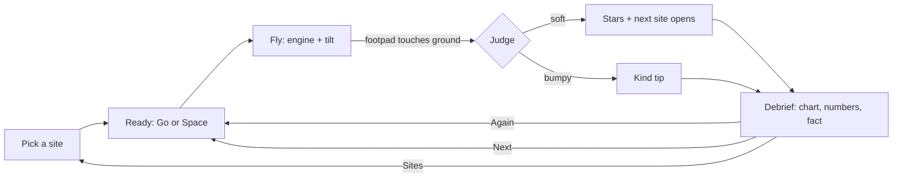
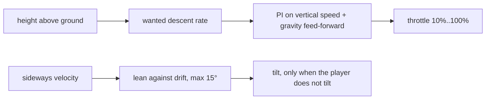

# Moon Touchdown: design

Fly a lander down to a real Moon landing site. Slow down, stop the sideways drift and touch down gently before the fuel runs out.
A run lasts 60 to 120 seconds. The debrief gives a clear "one more try" hook.

## 1. Game loop

1. Pick a site in the picker (it opens on load and from the left rail).
2. Ready: the lander waits above the site, offset from the target ring and drifting.
3. Fly: use the engine to slow the fall and tilt to stop the drift. The predicted touchdown ring shows where you will land and how hard.
4. Touchdown: the judge checks speed down, speed sideways, tilt and ground slope.
5. Debrief: stars, a descent chart, the touchdown numbers and a fact card. Buttons: Again, Next, Sites.

## 2. What it teaches

- Gravity and thrust: the engine must push harder than the Moon pulls to slow you down.
- The Moon pulls 1.62 m/s², the Earth 9.81 m/s². About one sixth, so a small push hovers.
- Fuel budget: fuel counts in seconds of hovering. Hovering too long high up leaves nothing for the touchdown.
- Reading gauges: speed down with green, yellow and red bands, a drift arrow, a tilt ball.

## 3. Physics (`src/sim/`, pure TypeScript, no three.js)

| Item | Value |
| --- | --- |
| Moon gravity | 1.62 m/s² |
| Earth gravity (g0 for the rocket equation) | 9.80665 m/s² |
| Specific impulse | 311 s (exhaust speed about 3050 m/s) |
| Full thrust | 45,000 N |
| Throttle | 0 = off, otherwise 10% to 100% |
| Dry mass | 4,300 kg |
| Fuel | 500 to 900 kg, by site |
| Step | fixed 1/60 s |
| Tilt | up to 30°, first-order response (time constant 0.25 s), at most 45°/s |
| Footpads | 4, in an X, 1.9 m out on each axis, 2.0 m below the centre of mass |

- **Integrator:** constant acceleration per step (position += v·dt + ½·a·dt², then v += a·dt). It is exact for free fall. The tests compare it with the analytic solution.
- **Fuel:** mdot = F / (Isp · g0). Mass is taken at the middle of each step. A full burn matches the rocket equation Δv = Isp · g0 · ln(m0 / m1) within 0.1%.
- **Seconds of fuel:** fuel / (hover fuel flow at the current mass). This is the number on the fuel bar.
- **Contact:** after each step, the sim checks the four footpads against the terrain. The first pad at or below the ground ends the flight. The lander settles on the ground.
- **Judge:** soft when speed down < 2.0 m/s, speed sideways < 1.2 m/s, tilt < 10° and ground slope < 12° (slope averaged over ±3 m). Otherwise the landing is "bumpy". The legs go boing, nobody is hurt, and the debrief gives a kind tip.
- **Stars:** one each for a soft touchdown, landing inside the 40 m target ring, and 30 s or more of fuel left. Bumpy landings get no stars.
- **Call-outs:** chimes and a banner at 60 s and 30 s of fuel. Historically, the first landing touched down with about a minute of margin.

### Hover helper

- The wanted descent rate is 1.5 m/s + 0.06 m/s per metre of height, up to 12 m/s. So it is 1.5 m/s at the ground.
  A fixed 1.5 m/s from 700 m would take almost 8 minutes and need more fuel than the lander carries.
- The PI controller has anti-windup: it integrates only while the throttle is not at a limit.
- When the player moves the throttle, the helper turns off and hands back the engine at its current power (no jump).
- A property test lands from random starts (350 to 700 m, up to 15 m/s down, up to 8 m/s drift) over flat ground. Every run is soft.

### Predictor

The predictor copies the state and integrates forward with the current input held. The hover helper keeps running inside the prediction.
It uses 1/15 s steps, looks at most 75 s ahead and interpolates the contact moment. The scene draws a ring at the touchdown point (green = soft, yellow = under 4 m/s, red = harder) and a ghost trail.
A property test checks the predictor against the full 1/60 s sim: within 0.3 s, 0.2 m/s and 1.5 m.

### Determinism

All randomness goes through the kit's seeded PRNG. Start conditions come from `hash(seed, site, run number)`.
A seed plus an input script replays the same trace. A test checks this.

## 4. Sites (easiest first)

| Site | Start height above target | Start offset | Drift | Fuel |
| --- | --- | --- | --- | --- |
| Sea of Tranquility | 350-450 m | 40-120 m | 0.5-2 m/s | 900 kg |
| Ocean of Storms | 400-500 m | 80-200 m | 1-3 m/s | 820 kg |
| Fra Mauro Highlands | 450-550 m | 120-260 m | 2-4 m/s | 740 kg |
| Descartes Highlands | 500-600 m | 160-320 m | 2.5-5 m/s | 660 kg |
| Taurus-Littrow Valley | 550-650 m | 200-380 m | 3-6 m/s | 580 kg |
| Hadley Rille | 600-700 m | 250-450 m | 4-7 m/s | 500 kg |

- The drift points roughly toward the target (±35°), like a real approach.
- The start is at least 150 m above the local ground.
- A soft landing on a site opens the next one. Progress and best stars are in `g499:moon-touchdown:progress`.

## 5. Terrain and look

- **Data:** LRO LOLA LDEM_512, resampled to 256 x 256 points at 60 m (15.3 km square) per site. Public domain. See `scripts/terrain/SOURCE.md`.
- **Scale:** true horizontal scale and vertical exaggeration **1.0**. The low sun makes the relief easy to read, so no exaggeration was needed.
- **Levels of detail** (by the kit quality tier):

| Tier | Far mesh | Near patch |
| --- | --- | --- |
| high | 256 x 256 | full data resolution, each cell split in 2 |
| medium | 128 x 128 | same |
| low | 64 x 64 | same |

- The **near patch** (about 1.9 km square) follows the lander. Its vertices sit on the real grid, so the footpads meet the drawn ground at every tier. The far mesh discards its pixels under the patch, and a skirt hides the seam.
- **Sun:** 12° above the horizon from the east-south-east. A shadow map cannot cover 15 km at useful resolution, so the long crater shadows are **baked** once per site: each grid point marches toward the sun and finds the highest horizon. Shadowed ground is dim and a little blue.
- **Lander shadow:** a sun shadow map rides along the sun ray through the lander. So its long shadow shows on the ground from any height. It is a good touchdown cue.
- **Regolith:** warm grey, brighter on steep slopes, with a broad seeded brightness variation.
- **Decoration, not data:** a seeded detail map adds small craters and grain to the shading (normal and brightness maps). It never changes the heights the lander touches.
- **Sky:** a seeded starfield, an original Earth (drawn in code), and a sun glow. The real Earth stands high overhead at these sites. The game places it low (about 9° up) so players can see it.
- **Lander:** original toy-like design. Gold-foil lower stage with clearcoat, four springy legs, a glossy cream cabin with two triangle windows, an antenna dish and corner thrusters. Two additive plume cones and a warm engine light.
- **Dust:** below 30 m the exhaust blows dust sideways in fast, flat sheets. There is no air on the Moon to slow it. Counts follow the tier and reduced motion.
- **Target ring:** a glowing ring of 40 m radius, draped on the real ground at the site centre, with a light beacon that fades near the ground.

## 6. Camera

- **Pick:** a slow orbit 900 m out and about 230 m up, so the ring, the horizon and the Earth all show.
- **Flight:** a chase camera behind (south of) the lander. It looks north, so screen right is east and "tilt right" moves the lander right.
  Distance and pitch follow the height. High up, the camera looks down at the ground ahead. Near the ground, it drops low for a dramatic touchdown view.
- **Landed:** a low, slow orbit around the lander.
- **Portrait:** a wider vertical field of view and a little more distance.

## 7. HUD and controls

- Readouts sit at the top, right of the rail: height, speed down (green under 2, yellow under 4, red above), drift arrow and speed, fuel in seconds with the 60 s mark, engine power with the hover mark, and a tilt ball with the 10° limit.
- Touch: the throttle slider is bottom-left, to the right of the rail and inside the safe area. The tilt pad is bottom-right. It is relative: where the thumb lands is the centre. The big helper button sits between them.
- The throttle lever uses a curve (throttle = 10% + 90% · k², k from the lever). Hover (about 19%) sits about a third of the way up, with more travel where it matters.
- Keyboard and gamepad mappings are in the README and in the "How to fly" card.

## 8. Menus (left rail)

Home, Sites, Pause, Restart, Helper, Touch pad, How to fly, Sound, Full screen, Privacy, Clear data.
Menus stay on the left (owner rule). On phones, the rail becomes a left drawer.

## 9. Honest simplifications

- The lander is a point mass with an ideal gimballed thrust vector. No rotational inertia, no reaction-control thrusters and no fuel slosh.
- Attitude follows the command with a simple first-order lag. The engine throttles instantly.
- No yaw: the lander always faces the camera.
- The ground is the 60 m data grid with bilinear smoothing. Boulders and craters smaller than about 120 m are not in the heights.
- Contact ends the flight at once. There is no leg-spring physics; the bounce of a bumpy landing is an animation.
- The start conditions are a short final descent (hundreds of metres). A real descent began about 15 km up and hundreds of kilometres away.
- Fuel amounts are scaled to make runs of 60 to 120 seconds, not real propellant loads.
- The Earth sits low in the sky for the view (see section 5).

## 10. Testing

- **Vitest + fast-check:** free fall, hover, fuel and mass, the rocket equation, tilt limits, footpad rotation, terrain sampling (exact at grid points, continuous), terrain decoding, the judge boundaries, stars, the hover helper (property), call-outs, fuel-out, determinism, start ranges, the predictor against the full sim (property), input mapping, progress storage and the baked shadows.
- **Playwright:** the kit smoke suite (load, privacy guard, left menu, manifest and service worker, offline reload, look gate, frame time, clear data, visual baseline) on desktop and phone projects. Plus a full round: pick Tranquility, turn on the helper (tap on phones, Space on desktop), step until touchdown, expect a soft landing, the second site open and the debrief visible. And a pause test.
- **Test mode:** `?test=1` freezes the clock and decoration, fixes the seed and exposes `window.__g499` (`step`, `idle`, `renders`, `state`). `state()` returns phase, site, altitude, vs, hs, fuelSeconds, outcome, stars, tick, paused, assist and more.
