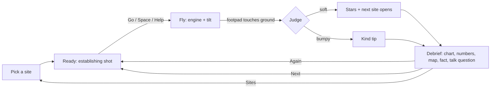
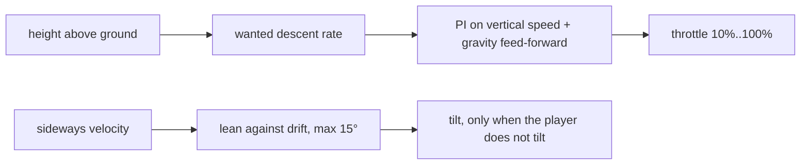

# Moon Touchdown: design

Fly a lander down to a real Moon landing site. Slow down, stop the sideways drift and touch down gently before the fuel runs out.
A run lasts 50 to 100 seconds. The debrief gives a clear "one more try" hook.

## 1. Game loop



1. Pick a site in the picker (it opens on load and from the left rail). Each card shows a small Moon map with the site dot.
2. Ready: an establishing shot shows the lander, the horizon and the Earth. The lander waits above the site, offset from the target ring and drifting.
3. Go: until the player has 1 soft landing without the helper, Go starts with the helper on. The engine is never off by surprise. The ready tip says "Help is on, slide to take over".
4. Fly: the camera swoops into the descent view (1.5 s; a cut with reduced motion). Use the engine to slow the fall and tilt to stop the drift. The predicted touchdown ring shows where you will land and how hard. Edge arrows point to the ring and to the predicted touchdown when they are out of the frame.
5. Touchdown: the judge checks speed down, speed sideways, tilt and ground slope.
6. Debrief: stars, a descent chart, the touchdown numbers, a Moon map, a fact, a "you vs the real crew" line and a "Talk about it" question. Buttons: Again, Next, Sites.

## 2. What it teaches

- Gravity and thrust: the engine must push harder than the Moon pulls to slow you down.
- The Moon pulls 1.62 m/s², the Earth 9.81 m/s². About one sixth, so a small push hovers.
- Fuel budget: fuel counts in seconds of hovering. Hovering costs fuel every second, so a slow, careful descent uses more fuel than a fast fall with a late, hard brake. The helper is careful, so it lands safely but below the fuel star. To earn the fuel star, the child must fly the engine well.
- Reading gauges: speed down with green, yellow and red bands that follow the height ("fast is OK up high, slow near the ground"), a drift arrow, a tilt ball.

## 3. Physics (`src/sim/`, pure TypeScript, no three.js)

| Item | Value |
| --- | --- |
| Moon gravity | 1.62 m/s² |
| Earth gravity (g0 for the rocket equation) | 9.80665 m/s² |
| Specific impulse | 311 s (exhaust speed about 3050 m/s) |
| Full thrust | 45,000 N |
| Throttle | 0 = off, otherwise 10% to 100% |
| Dry mass | 4,300 kg (a game value, see section 9) |
| Fuel | 177 to 232 kg, by site (section 4) |
| Step | fixed 1/60 s |
| Tilt | up to 30°, first-order response (time constant 0.25 s), at most 45°/s |
| Footpads | 4, in an X, 1.9 m out on each axis, 2.0 m below the centre of mass |

- **Integrator:** constant acceleration per step (position += v·dt + ½·a·dt², then v += a·dt). It is exact for free fall. The tests compare it with the analytic solution.
- **Fuel:** mdot = F / (Isp · g0). Mass is taken at the middle of each step. A full burn matches the rocket equation Δv = Isp · g0 · ln(m0 / m1) within 0.1%.
- **Seconds of fuel:** fuel / (hover fuel flow at the current mass). This is the number on the fuel bar.
- **Contact:** after each step, the sim checks the four footpads against the terrain. The first pad at or below the ground ends the flight. The lander settles on the ground.
- **Judge:** soft when speed down < 2.0 m/s, speed sideways < 1.2 m/s, tilt < 10° and ground slope < 12° (slope averaged over ±3 m). Otherwise the landing is "bumpy". The legs go boing, nobody is hurt, and the debrief gives a kind tip.
- **Stars:** one each for a soft touchdown, landing inside the 40 m target ring, and 30 s or more of fuel left. Bumpy landings get no stars.
- **Call-outs:** chimes and a banner at 60 s and 30 s of fuel. The first crew heard the "30 seconds" fuel call just before they touched down.

### Fuel (F2)

The fuel star must be earned. The game must stay kind.

```text
 fuel bar     0 s        15 s         30 s              60 s                full
              |----------|------------*|----------------|-------------------|
                   low-fuel prompt    star tick         60 s tick
                   (manual only)      (fuel star line)

 helper landing leaves  ~13-22 s  (below the star: no free star)
 efficient pilot leaves ~38-50 s  (above the star)
```

- **Star line:** a filled star tick on the fuel bar at 30 s, a plain tick at 60 s. Below 30 s the bar turns red and the star tick fades. The number shows too, so colour is never the only cue.
- **Helper:** it holds a safe, slow profile, so it burns about 50 to 80 s of hover fuel. The start fuel per site leaves it about 13 to 22 s. It always lands softly with 10 s or more. It never earns the fuel star.
- **Efficient pilot:** fall fast up high (engine off to about 20 m/s), brake late and hard (60% of the spare thrust), hover little, and lean only while the engine pushes. This keeps 30 s or more on sites 1 to 3.
- **Why fast falling saves fuel:** vertical momentum gives the engine push exactly. In hover-seconds, push = flight time + (speed down now − speed down at touchdown) / g. A shorter flight burns less.
- **Low-fuel prompt:** a manual pilot below 15 s gets one gentle prompt per run, "Low fuel: tap Help to land safely", with the helper icon. The Help button pulses.
- **Helper takeover:** the helper can take over at any time. `assistFuelNeed` (in `src/sim/assist.ts`) estimates the hover-seconds it needs from the HUD values. A test checks that the helper lands softly from mid-flight states when the fuel left covers that estimate.
- **Out of fuel:** still possible when flying by hand. The debrief explains it kindly and gives a tip. Up high: "Out of fuel up high: start braking a bit later next time." Near the ground: "Out of fuel just above the ground. So close!"
- **Debrief:** "Fuel left: N s (star at 30 s)" with a star that fills when earned. When the child flew and missed the ring or fuel star, the debrief also shows "Helper would have left ~M s". The game flies the helper from the same start on the same ground to get M.

### Hover helper



- The helper flies the engine and stops the drift. It does not steer to the ring: the child steers. At 200 m in a helper flight, the ring arrow and the tilt pad pulse once. When a helped landing misses the ring, the debrief says "The helper flies the engine. You steer: tilt toward the ring."
- The wanted descent rate is 1.5 m/s + 0.06 m/s per metre of height, up to 12 m/s. So it is 1.5 m/s at the ground.
  A fixed 1.5 m/s from 700 m would take almost 8 minutes and need more fuel than the lander carries.
- The PI controller has anti-windup: it integrates only while the throttle is not at a limit.
- When the player moves the throttle, the helper turns off and hands back the engine at its current power (no jump).
- A property test lands from random starts (350 to 700 m, up to 15 m/s down, up to 8 m/s drift) over flat ground. Every run is soft.
- `src/sim/helper-sites.test.ts` runs the helper on the real terrain file of each site from 16 seeded starts. Every run must be soft, with fuel left in [10, 25) s and no fuel star. It also flies a scripted efficient pilot (30 s or more on sites 1 to 3) and helper takeovers from mid-flight states. Each block prints a `console.table` of the measured numbers.
- A landing counts as "with help" when the helper was on below 60 m or at touchdown. The picker shows a small helper mark next to those best stars.

### Predictor

The predictor copies the state and integrates forward with the current input held. The hover helper keeps running inside the prediction.
It uses 1/15 s steps, looks at most 110 s ahead and interpolates the contact moment. The scene draws a ring at the touchdown point (green = soft, yellow = under 4 m/s, red = harder) and a ghost trail.
A property test checks the predictor against the full 1/60 s sim: within 0.3 s, 0.2 m/s and 1.5 m.

### Determinism

All randomness goes through the kit's seeded PRNG. Start conditions come from `hash(seed, site, run number)`.
A seed plus an input script replays the same trace. A test checks this.

## 4. Sites (easiest first)

| Site | Start height above target | Start offset | Drift | Fuel |
| --- | --- | --- | --- | --- |
| Sea of Tranquility | 350-450 m | 40-120 m | 0.5-2 m/s | 177 kg |
| Ocean of Storms | 400-500 m | 80-200 m | 1-3 m/s | 188 kg |
| Fra Mauro Highlands | 450-550 m | 120-260 m | 2-4 m/s | 198 kg |
| Descartes Highlands | 500-600 m | 160-320 m | 2.5-5 m/s | 208 kg |
| Taurus-Littrow Valley | 550-650 m | 200-380 m | 3-6 m/s | 220 kg |
| Hadley Rille | 600-700 m | 250-450 m | 4-7 m/s | 232 kg |

- **Fuel rule (F2):** start fuel = the helper's worst-seed use on the real terrain + about 31 kg (about 13.5 s of hover). So the helper lands below the 30 s fuel star, and an efficient pilot lands above it.
- **Per-site fuel.** "Calc" values are hand calculations from the F1 measurements. Replace them with the values from the `console.table` in `src/sim/helper-sites.test.ts`.

| Site | Start fuel | Full tank | Helper left | Efficient pilot left |
| --- | --- | --- | --- | --- |
| Sea of Tranquility | 177 kg | 74 s | calc 13.5-21 s | calc about 40 s |
| Ocean of Storms | 188 kg | 79 s | calc 13.5-22 s | calc about 42 s |
| Fra Mauro Highlands | 198 kg | 83 s | calc 13.5-21 s | calc about 44 s |
| Descartes Highlands | 208 kg | 87 s | calc 13.5-21 s | calc about 45 s |
| Taurus-Littrow Valley | 220 kg | 92 s | calc 13.5-23 s | calc about 47 s |
| Hadley Rille | 232 kg | 96 s | calc 13.5-23 s | calc about 50 s |

- The efficient pilot does not steer to the ring. On sites 4 to 6 it can land on a steep slope. The test prints those runs but does not assert them.
- The drift points roughly toward the target (±35°), like a real approach.
- The start is at least 150 m above the local ground.
- A soft landing on a site opens the next one.
- **Progress** (schema v2) is in `g499:moon-touchdown:progress`: open sites, best stars, a `helped` mark per site and `solo` (1 soft landing without the helper). v1 data migrates on load with no helper marks.

## 5. Terrain and look

- **Data:** LRO LOLA LDEM_512, resampled to 256 x 256 points at 60 m (15.3 km square) per site. Public domain. See `scripts/terrain/SOURCE.md`.
- **Scale:** true horizontal scale and vertical exaggeration **1.0**. The low sun makes the relief easy to read, so no exaggeration was needed.
- **Levels of detail** (by the kit quality tier):

| Tier | Far mesh | Near patch |
| --- | --- | --- |
| high | 256 x 256 | full data resolution, each cell split in 2 |
| medium | 128 x 128 | same |
| low | 64 x 64 | same |

- The **near patch** (about 1.9 km square) follows the lander. Its vertices sit on the real grid, so the footpads meet the drawn ground at every tier. The far mesh discards its pixels 1 m inside the patch edge. A two-sided skirt hides the seam from inside and outside the patch.
- **Sun:** 12° above the horizon from the east-south-east, intensity 6.5, renderer exposure 0.9. A shadow map cannot cover 15 km at useful resolution, so the long crater shadows are **baked** once per site: each grid point marches toward the sun and finds the highest horizon. Shadowed ground is dim and a little blue.
- **Lander shadow:** a sun shadow map rides along the sun ray through the lander. At a 12° sun the shadow falls about 4.7 × the height to the west, so it shows only in the last metres.
- **Ground glow (a visual aid, not physics):** below 40 m a soft warm glow lies on the ground under the lander. It gets brighter and tighter as the lander comes down.
- **Lander halo:** a soft halo, a fixed 52 px on screen, sits behind the lander so it reads from high up. It fades out between 90 m and 40 m.
- **Regolith per site:** maria (Tranquility, Storms) are darker and warmer, with fewer and smaller craters. Highlands (Fra Mauro, Descartes) are lighter, with more craters. The Taurus-Littrow floor is dark under bright massif slopes. Steep slopes are brighter.
- **Brightness variation:** three octaves of seeded noise, about ±12%.
- **Decoration, not data:** a seeded detail map adds craters and grain to the shading (normal and brightness maps). It never changes the heights the lander touches.
  - About 250 craters (× the site density) with a power-law size (radius 1.5 to 40 px): many small, few large.
  - About 14% of the small craters are fresh: a dark floor, a bright rim and a bright halo (about ±12%).
  - The shader samples the map at 2 scales: the 150 m tile and a copy turned 37° at about 520 m. It mixes them 60/40, so the repeat does not show. The detail normals fade to 30% beyond 600 m.
- **Sky:** a seeded starfield, an original Earth (drawn in code), and a sun glow. The real Earth stands high overhead at these sites. The game places it low (about 3.5° up, a little left of north), so it shows between the horizon and the HUD.
- **Lander:** original toy-like design. Gold-foil lower stage with clearcoat, four springy legs, a glossy cream cabin with two triangle windows, an antenna dish and corner thrusters. Two additive plume cones and a warm engine light.
- **Dust:** below 30 m the exhaust blows dust sideways in fast, flat sheets. There is no air on the Moon to slow it. Counts follow the tier and reduced motion.
- **Target ring:** a glowing ring of 40 m radius, draped on the real ground at the site centre, with a light beacon. In the ready shot the beacon reaches up to about 85% of the start height. It fades near the ground.

## 6. Camera

```text
 side view, descent cam (above 80 m)        low chase cam (below 30 m)
 cam *                                        cam *--__
     |\  70° above the lander, 60-90 m                 `--__  12° above the lander, 30 m
     | o lander (upper half of the frame)          o lander
     | |                                          _|_________ ground and horizon
     | x ground point (lower half)
```

- **Pick:** a slow orbit 900 m out and about 230 m up, so the ring, the horizon and the Earth all show.
- **Ready:** an establishing shot 150 m behind the lander and 12 m above it, looking toward the Earth and 8° down. The lander, the horizon and the Earth show. The ring and the beacon show when the target is ahead; otherwise the edge arrow points to them.
- **Swoop:** on Go the camera moves into the descent cam in 1.5 s with an ease-in-out. With reduced motion it cuts at once.
- **Descent cam (above 80 m):** behind (south of) the lander, 70° above it, 60 to 90 m away. The pitch sits between the lander and the ground point under it, so both are in frame. It looks north, so screen right is east and "tilt right" moves the lander right.
- **Blend (80 m to 30 m):** smoothstep into the low chase cam (12° above the lander, 30 m away). The ground point stays at least 5° inside the frame.
- **Portrait:** a wider vertical field of view (62°), a little more distance, and the aim moves down, so the ground point stays above the bottom 30% of the frame (the touch controls).
- **Edge arrows:** when the ring centre or the predicted touchdown point is outside the usable frame (below the HUD, above the touch controls, inside the sides), an arrow on the frame edge points to it. The ring arrow is mint and shows the distance in metres. The marker arrow has the marker colour.
- **Landed:** a low, slow orbit around the lander.

## 7. HUD and controls

- Readouts sit at the top, right of the rail: height, speed down, drift arrow and speed, fuel in seconds with the 60 s mark and the 30 s star tick, engine power with the hover mark, and a tilt ball with the 10° limit.
- **Speed-down bands follow the height.** The safe speed is the helper's target speed (1.5 + 0.06 × height, up to 12 m/s). Green is up to the safe speed + 0.5 m/s, yellow up to + 2.5 m/s, red above. Below 10 m the strict touchdown bands apply: green under 2, yellow under 4. The green part of the bar grows to the safe speed. The red mark does not blink while the helper flies. The debrief chart shows the same envelope as a soft green band.
- Touch: the throttle slider is bottom-left, to the right of the rail and inside the safe area. It is **relative**: a drag up or down moves the lever by the drag distance, and a tap changes nothing. The tilt pad is bottom-right. It is relative too: where the thumb lands is the centre. The big **Help** button (a small lander in a cupped hand, with the word "Help") sits between them. It pulses once on the first ready screen.
- The throttle lever uses a curve (throttle = 10% + 90% · k², k from the lever). Hover (about 19%) sits about a third of the way up, with more travel where it matters.
- Keyboard: W/S engine, arrow keys or I J K L tilt (A/D and E/Q still work). Space = Help. P pause, M sound.
- On Android phones a short buzz marks the touchdown (only with touch controls on, sound on and reduced motion off).
- Gamepad mappings are in the README.

## 8. Menus (left rail)

Home, Sites, Pause, Restart, Help, Touch pad, How to fly, Sound, Full screen, Privacy, Clear data.
Menus stay on the left (owner rule). On phones, the rail becomes a left drawer. The rail title "Moon Touchdown" uses a smaller font so it fits on 2 lines.

## 9. Honest simplifications

- The lander is a point mass with an ideal gimballed thrust vector. No rotational inertia, no reaction-control thrusters and no fuel slosh.
- Attitude follows the command with a simple first-order lag. The engine throttles instantly.
- No yaw: the lander always faces the camera.
- The ground is the 60 m data grid with bilinear smoothing. Boulders and craters smaller than about 120 m are not in the heights.
- Contact ends the flight at once. There is no leg-spring physics; the bounce of a bumpy landing is an animation.
- The start conditions are a short final descent (hundreds of metres). A real descent began about 15 km up and hundreds of kilometres away.
- Fuel amounts are scaled for runs of about 40 to 90 seconds, not real propellant loads.
- The real engine throttled from about 10% to 60%, plus a fixed full setting. The game allows any setting from 10% to 100%.
- The dry mass is a game value. The real lander was heavier at touchdown (about 7,000 kg), with hover at about 25 to 30% throttle. In the game, hover is about 17 to 19%.
- The real manual attitude rates were slower (about 20°/s). The game allows 45°/s.
- The fuel seconds use the current mass. That is about 9% conservative against the exact rocket-equation value.
- The Earth sits low in the sky for the view (see section 5).
- The ground glow under the lander is a visual aid, not a physical effect.

## 10. Shared play

- Each site has 2 or 3 short, true facts. They take turns, one per run.
- The debrief shows a small Moon map (an original drawing in code) with the site dot, and the line "This ground is real. A laser on a spacecraft measured every hill."
- "You vs the real crew": at Tranquility, "The real crew touched down here at about 0.5 m/s. You: 1.4 m/s." At other sites the line compares with the design limit of the real landing legs (about 3 m/s down).
- One "Talk about it" question per site for the parent, for example "Why does the lander need only a small push to hover here?"

## 11. Testing

- **Vitest + fast-check:** free fall, hover, fuel and mass, the rocket equation, tilt limits, footpad rotation, terrain sampling (exact at grid points, continuous), terrain decoding, the judge boundaries, stars, the hover helper (property, flat ground), the hover helper on the real terrain of all 6 sites (fuel left, call-outs), call-outs, fuel-out, determinism, start ranges, the predictor against the full sim (property), input mapping, progress storage and the v1 to v2 migration, the height-aware speed bands, the edge-arrow placement, the crater size law, the Moon map projection and the baked shadows.
- **Playwright:** the kit smoke suite (load, privacy guard, left menu, manifest and service worker, offline reload, look gate, frame time, clear data, visual baseline) on desktop and phone projects. Plus a full round: pick Tranquility, turn on the helper (tap on phones, Space on desktop), step until touchdown, expect a soft landing, the second site open and the debrief visible. The round also checks that the debrief card and an earned star are fully opaque and that the star is lemon yellow. And a pause test.
- **Test mode:** `?test=1` freezes the clock and decoration, fixes the seed and exposes `window.__g499` (`step`, `idle`, `renders`, `state`). `state()` returns phase, site, altitude, vs, hs, fuelSeconds, outcome, stars, tick, paused, assist, helped, solo, ringOnScreen, markerOnScreen and more.
