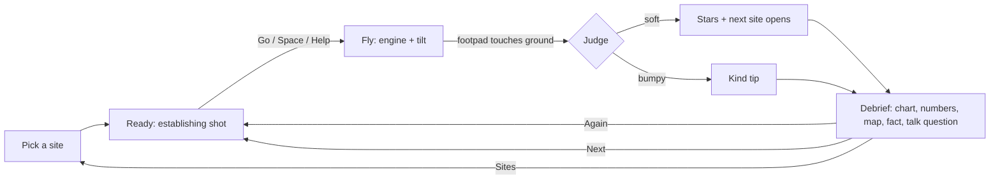
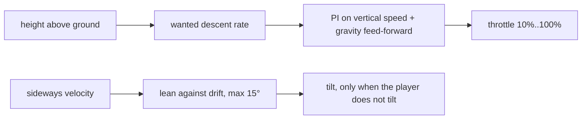

# Moon Touchdown: design

Fly a lander down to a real Moon landing site. Slow down, stop the sideways drift and touch down gently before the fuel runs out.
A run lasts 50 to 100 seconds. The debrief gives a clear "one more try" hook.

## 1. Game loop



1. Pick a site in the picker (it opens on load and from the left rail). Each card shows a small Moon map with the site dot.
2. Ready: an establishing shot shows the lander, the horizon and the Earth. The lander waits above the site, offset from the target ring and drifting.
3. Go: until the player has 1 soft landing without the helper, Go starts with the helper on. The engine is never off by surprise. The ready tip says "Help is on, slide to take over" with the touch pad on. Without it, it says "Press W for engine, arrows to steer, Space for Help" with key caps.
4. Fly: the camera swoops into the descent view (1.5 s; a cut with reduced motion). Use the engine to slow the fall and tilt to stop the drift. The predicted touchdown ring shows where you will land and how hard. Edge arrows point to the ring and to the predicted touchdown when they are out of the frame.
5. Touchdown: the judge checks speed down, speed sideways, tilt and ground slope.
6. Debrief: stars, a descent chart, the touchdown numbers, a Moon map, a fact, a "you vs the real crew" line and a "Talk about it" question. Buttons: Again, Next, Sites.

## 2. What it teaches

- Gravity and thrust: the engine must push harder than the Moon pulls to slow you down.
- The Moon pulls 1.62 m/s², the Earth 9.81 m/s². About one sixth, so a small push hovers.
- Fuel budget: fuel counts in seconds of hovering. Hovering costs fuel every second, so a slow, careful descent uses more fuel than a fast fall with a late, hard brake. The helper is careful, so it lands safely but below the fuel star. To earn the fuel star, the child must fly the engine well.
- Reading gauges: speed down with green, yellow and red bands that follow the height ("fast is OK up high, slow near the ground"), a drift arrow, a tilt ball. In manual flight up high a calm "slow" zone sits left of the green: hovering costs fuel (F6).

## 3. Physics (`src/sim/`, pure TypeScript, no three.js)

| Item | Value |
| --- | --- |
| Moon gravity | 1.62 m/s² |
| Earth gravity (g0 for the rocket equation) | 9.80665 m/s² |
| Specific impulse | 311 s (exhaust speed about 3050 m/s) |
| Full thrust | 45,000 N |
| Throttle | 0 = off, otherwise 10% to 100% |
| Dry mass | 4,300 kg (a game value, see section 9) |
| Fuel | 177 to 232 kg, by site (section 4) |
| Step | fixed 1/60 s |
| Tilt | up to 30°, first-order response (time constant 0.25 s), at most 45°/s |
| Footpads | 4, in an X, 1.9 m out on each axis, 2.0 m below the centre of mass |

- **Integrator:** constant acceleration per step (position += v·dt + ½·a·dt², then v += a·dt). It is exact for free fall. The tests compare it with the analytic solution.
- **Fuel:** mdot = F / (Isp · g0). Mass is taken at the middle of each step. A full burn matches the rocket equation Δv = Isp · g0 · ln(m0 / m1) within 0.1%.
- **Seconds of fuel:** fuel / (hover fuel flow at the current mass). This is the number on the fuel bar.
- **Contact:** after each step, the sim checks the four footpads against the terrain. The first pad at or below the ground ends the flight. The lander settles on the ground.
- **Judge:** soft when speed down < 2.0 m/s, speed sideways < 1.2 m/s, tilt < 10° and ground slope < 12° (slope averaged over ±3 m). Otherwise the landing is "bumpy". The legs go boing, nobody is hurt, and the debrief gives a kind tip.
- **Stars:** one each for a soft touchdown, landing inside the 40 m target ring, and 30 s or more of fuel left. Bumpy landings get no stars.
- **Call-outs:** chimes and a banner at 60 s and 30 s of fuel. The first crew heard the "30 seconds" fuel call just before they touched down.

### Fuel (F2)

The fuel star must be earned. The game must stay kind.

```text
 fuel bar     0 s                    30 s              60 s                full
              |-----------------------*|----------------|-------------------|
                                     star tick         60 s tick
                                     (fuel star line)
 low-fuel prompt (manual flight): when fuel < helper need + 6 s ("tap Help"),
                                  or fuel < helper need and falling fast ("Brake now")

 helper landing leaves  ~13-22 s  (below the star: no free star)
 efficient pilot leaves ~38-50 s  (above the star)

 speed bar, manual flight above 10 m (zone gauge, F6)
   0     16%            34%        50%                         100%
   |/////|==============|::::::::::|...........................|
    slow   green          yellow     red
    (pale blue, striped)  fast but   brake now
    "uses fuel"           stoppable
   aim: the middle of green = 0.925 x safe + 0.25 m/s (about the helper's speed)
```

- **Star line:** a filled star tick on the fuel bar at 30 s, a plain tick at 60 s. Below 30 s the star tick fades. In manual flight the bar turns red. While the helper flies it stays lemon: the helper still lands safely, so it is not danger. The number shows too, so colour is never the only cue.
- **30 s call-out:** in manual flight, a red "30 seconds of fuel". While the helper flies (and still has the fuel it needs), a lemon "Fuel star gone. Help still lands safely."
- **Helper:** it holds a safe, slow profile, so it burns about 50 to 80 s of hover fuel. The start fuel per site leaves it about 13 to 22 s. It always lands softly with 10 s or more. It never earns the fuel star.
- **Efficient pilot:** fly by the HUD and never in the red. Fall fast up high (engine off to about 20 m/s: yellow, fast but stoppable), brake late and hard (60% of the spare thrust, to 3 m/s at 10 m), hover little, and lean only while the engine pushes. This keeps 30 s or more on sites 1 to 3.
- **Why fast falling saves fuel:** vertical momentum gives the engine push exactly. In hover-seconds, push = flight time + (speed down now − speed down at touchdown) / g. A shorter flight burns less.
- **Speed band and fuel (F6):** the same identity sets the green band. A steady descent at v m/s costs 1 / v hover-seconds per metre. Before F6, green was [0, safe + 0.5], so a child who kept the mark in the middle of green fell at about half the helper's speed and used about twice its fuel per metre. Now, in manual flight above 10 m, green is [0.85 × safe, safe + 0.5] and a calm "slow" zone sits below it. The middle of green is 0.925 × safe + 0.25 m/s, about the helper's own speed (section 4 has the numbers). Below 10 m the touchdown bands do not change: slow is good near the ground.
- **Hover notch (F6):** when the player lets go of the engine (W / S, the stick or the slider), the lever slides back to the hover point in less than 0.2 s. So "hands off" keeps the speed down, and a late release does not keep braking (or falling) on its own. A press from the notch starts gently (30% of the key rate for the first 0.45 of lever), so small corrections stay small. A press from engine-off keeps the first-press step and the full rate.
- **Low-fuel prompt** (`lowFuelPrompt` in `src/sim/assist.ts`): it uses the helper's real need, `assistFuelNeed`, every frame of a manual flight. So the promise "tap Help to land safely" is only made while it is true. Each prompt shows once per run.
  - `'help'`: fuel left is at least the need, and less than the need + 6 s. The prompt says "Low fuel: tap Help to land safely", with the helper icon. The Help button pulses.
  - `'brake'`: fuel left is less than the need (or the fall cannot be stopped in time), and the lander falls faster than the green speed. The prompt says "Brake now: slide up" with a slider icon (or "Brake now: hold W" with a key-cap).
- **Helper takeover:** the helper can take over at any time. `assistFuelNeed` (in `src/sim/assist.ts`) estimates the hover-seconds it needs from the HUD values. Tests check that the helper lands softly from mid-flight states when the fuel left covers that estimate, and from the exact moment the prompt says "help", on every site.
- **Out of fuel:** still possible when flying by hand. The debrief explains it kindly and gives a tip. Up high: "Out of fuel up high: start braking a bit later next time." Near the ground: "Out of fuel just above the ground. So close!" When the tank ran dry while Help was flying, the text is about Help, never about the child's braking: "Help started too late to save fuel. Tip: tap Help earlier next time, as soon as the Help sign shows."
- **Debrief:** "Fuel left: N s (star at 30 s)" with a star that fills when earned. When the child flew and missed the ring or fuel star, the debrief also shows "Helper would have left ~M s". The game flies the helper from the same start on the same ground to get M.

### Hover helper



- The helper flies the engine and stops the drift. It does not steer to the ring: the child steers. At 200 m in a helper flight, the ring arrow and the tilt pad pulse once. When a helped landing misses the ring, the debrief says "The helper flies the engine. You steer: tilt toward the ring."
- The wanted descent rate is 1.5 m/s + 0.06 m/s per metre of height, up to 12 m/s. So it is 1.5 m/s at the ground.
  A fixed 1.5 m/s from 700 m would take almost 8 minutes and need more fuel than the lander carries.
- The PI controller has anti-windup: it integrates only while the throttle is not at a limit.
- When the player moves the throttle, the helper turns off and hands back the engine at its current power (no jump). When the player then lets go, the lever slides into the hover notch (section 7).
- A property test lands from random starts (350 to 700 m, up to 15 m/s down, up to 8 m/s drift) over flat ground. Every run is soft.
- `src/sim/helper-sites.test.ts` runs the helper on the real terrain file of each site from 16 seeded starts. Every run must be soft, with fuel left in [10, 25) s and no fuel star. It also flies a scripted efficient pilot by the HUD bands (never red; 30 s or more on sites 1 to 3), helper takeovers from mid-flight states and at the moment the prompt says "help" (every site), a "ring + thrifty" pilot (3 stars on every site), a noisy novice who takes over at 150 m, and real-input novices (keys and slider through `ControlShaper`) who take over at 300 m and 150 m, with the low-fuel prompt (f) and without it (g). Each block prints a `console.table` of the measured numbers (see section 4).
- A landing counts as "with help" when the helper was on below 60 m or at touchdown. The picker shows a small helper mark next to those best stars.

### Predictor

The predictor copies the state and integrates forward with the current input held. The hover helper keeps running inside the prediction.
It uses 1/15 s steps, looks at most 110 s ahead and interpolates the contact moment. The scene draws a ring at the touchdown point (green = soft, yellow = under 4 m/s, red = harder) and a ghost trail.
A property test checks the predictor against the full 1/60 s sim: within 0.3 s, 0.2 m/s and 1.5 m.
While the player holds a key, the pad or a stick, the input is a short press, not a plan (R3 finding 9). Then the prediction fades a held tilt to the helper's lean and a held throttle (manual flight) to hover over 1.5 s (`LIVE_INPUT_FADE`). So a lean toward the ring does not throw the marker far away in red. With no input the prediction holds the input as is, and the property test above still covers that case.

### Determinism

All randomness goes through the kit's seeded PRNG. Start conditions come from `hash(seed, site, run number)`.
A seed plus an input script replays the same trace. A test checks this.

## 4. Sites (easiest first)

| Site | Start height above target | Start offset | Drift | Fuel |
| --- | --- | --- | --- | --- |
| Sea of Tranquility | 350-450 m | 40-120 m | 0.5-2 m/s | 177 kg |
| Ocean of Storms | 400-500 m | 80-200 m | 1-3 m/s | 188 kg |
| Fra Mauro Highlands | 450-550 m | 120-260 m | 2-4 m/s | 198 kg |
| Descartes Highlands | 500-600 m | 160-320 m | 2.5-5 m/s | 208 kg |
| Taurus-Littrow Valley | 550-650 m | 200-380 m | 3-6 m/s | 220 kg |
| Hadley Rille | 600-700 m | 250-450 m | 4-7 m/s | 232 kg |

- **Fuel rule (F2):** start fuel = the helper's worst-seed use on the real terrain + about 31 kg (about 13.5 s of hover). So the helper lands below the 30 s fuel star, and an efficient pilot lands above it.
- **Per-site fuel (measured 2026-10-30, `src/sim/helper-sites.test.ts`, real terrain, 16 seeds per site for (a), (b), (d) and 20 for (e)).** Helper left (a) is min-max; pilot left (b) and (d) are min / median.

| Site | Start fuel | Full tank | Helper left (a), soft | Efficient pilot left (b), soft, fuel star | Ring + thrifty (d): 3-star runs, left min / median | Novice takeover at 150 m (e): soft, left median |
| --- | --- | --- | --- | --- | --- | --- |
| Sea of Tranquility | 177 kg | 74 s | 13.2-20.7 s, 16/16 | 41.2 / 43.6 s, 16/16, 16/16 | 16/16, 36.1 / 41.2 s | 20/20, 18.1 s |
| Ocean of Storms | 188 kg | 79 s | 13.6-21.3 s, 16/16 | 43.0 / 45.3 s, 16/16, 16/16 | 15/16, 35.8 / 41.3 s | 20/20, 18.2 s |
| Fra Mauro Highlands | 198 kg | 83 s | 13.5-21.1 s, 16/16 | 44.3 / 46.7 s, 16/16, 16/16 | 14/16, 35.7 / 40.5 s | 20/20, 18.0 s |
| Descartes Highlands | 208 kg | 87 s | 13.3-21.2 s, 16/16 | 45.8 / 48.1 s, 16/16, 16/16 | 11/16, 35.6 / 39.3 s | 20/20, 17.9 s |
| Taurus-Littrow Valley | 220 kg | 92 s | 13.4-22.2 s, 16/16 | 47.8 / 50.6 s, 16/16, 16/16 | 10/16, 35.7 / 39.2 s | 20/20, 18.4 s |
| Hadley Rille | 232 kg | 96 s | 13.9-22.9 s, 16/16 | 50.0 / 52.8 s, 16/16, 16/16 | 7/16, 35.6 / 37.9 s | 20/20, 18.9 s |

- The helper never earns the fuel star (0 of 96) and every helped run lands softly. A HUD-only efficient pilot earns it on every run with 0 red steps. 3 stars are possible on every site. The scripted (d) pilot misses the ring or touches down hard on harder sites only when the late side drift beats its simple 12-degree lean (the "drift" bumps); a person who leans earlier does better. No start fuel change was needed.

- **Tests that prove the stars are fair** (`src/sim/helper-sites.test.ts`, every block prints its table):
  - (b) The efficient pilot flies by the HUD bands and never shows red. It keeps 30 s or more on sites 1 to 3. It does not steer to the ring. On sites 4 to 6 the test prints the runs but does not assert the fuel.
  - (d) The "ring + thrifty" pilot leans toward the ring (at most 12°, only while the engine pushes) and flies by the HUD bands. While high, it plans its fall speed: as fast as 20 m/s while there is time to reach the ring, but never so slow that it spends the fuel-star reserve. It must get 3 stars on at least 1 seed on every site, with a median fuel left of 33 s or more on sites 1 to 3.
  - (e) A novice reads the HUD 0.4 s late and moves the lever with ±15% noise. It takes over from Help at 150 m. It must land softly in 80% or more of 20 seeds on every site.
  - (f) Real-input novices (R3 finding 2) use the game's own input path. Help flies down to the takeover height (300 m or 150 m) and hands the engine over at its own throttle, as in the game. The child reads the HUD 0.4 s late and moves only the engine. The child aims the speed mark at the middle of the green band from `vsLimits` (F6: in manual flight up high, green starts at the slow zone):
    - **Keys:** W and S through `mapKeyboard` and `ControlShaper.update`, so the first-press step (0.08), the key lever rate (0.85/s) and the hover notch are the real ones. The child holds W while the speed mark is past the green band, until the mark crosses the middle of green. The child holds S while the mark is in the slow zone or the lander climbs, until the mark is back at the middle.
    - **Slider:** the same rule, with one relative drag of 10% lever per look (every 0.4 s). The thumb rests on the slider while the child corrects, and lifts when the mark is back at the middle (the lever then slides into the hover notch, as in the game).
    - Both tap Help when the game shows "Low fuel: tap Help", the same as a child who reads the prompt. The table shows how many landed by hand and how many took Help.
    - Each pilot must land softly in 80% or more of 12 seeds, and **by hand in 60% or more** (F6), for each site and each takeover height.
  - (g) The same two novices **without** the prompt (F6, `ignorePrompt`): a child who keeps flying by hand to the ground. Each must land softly by hand in 80% or more of 12 seeds for each site and takeover height, and never run out of fuel on sites 1 to 3.
  - If a site fails (d), raise its start fuel by about 2.5 kg per missing second, while the helper's left stays in [10, 25) s in (a).
  - If (f) or (g) fails, see "Knobs" below. Do not change the asserts.

**Real-input novices (f), measured table (after F6).** Every run soft; cell: by hand / Help at prompt (the prompt never showed). (g) below has the fuel-left numbers.

| Site | Keys, take over at 300 m: soft (by hand / Help at prompt) | Keys, 150 m | Slider, 300 m | Slider, 150 m |
| --- | --- | --- | --- | --- |
| Sea of Tranquility | 12/12 (12 / 0) | 12/12 (12 / 0) | 12/12 (12 / 0) | 12/12 (12 / 0) |
| Ocean of Storms | 12/12 (12 / 0) | 12/12 (12 / 0) | 12/12 (12 / 0) | 12/12 (12 / 0) |
| Fra Mauro Highlands | 12/12 (12 / 0) | 12/12 (12 / 0) | 12/12 (12 / 0) | 12/12 (12 / 0) |
| Descartes Highlands | 12/12 (12 / 0) | 12/12 (12 / 0) | 12/12 (12 / 0) | 12/12 (12 / 0) |
| Taurus-Littrow Valley | 12/12 (12 / 0) | 12/12 (12 / 0) | 12/12 (12 / 0) | 12/12 (12 / 0) |
| Hadley Rille | 12/12 (12 / 0) | 12/12 (12 / 0) | 12/12 (12 / 0) | 12/12 (12 / 0) |

Expectation before the F5 run (hand estimate): the middle of the green band was about half the helper's speed, so a child who holds it needs more fuel than the tank holds. **Measured by the operator after F5:** soft 144/144, but by hand 0 of 144: every run reached "tap Help". With the prompt ignored, every run (keys and slider, every site, both takeover heights) ran dry and fell fast. F6 changes the band, the lever and the tests (below). The table above is the (f) run after F6 (288 of 288 runs by hand, keys and slider).

#### Fuel per metre: the middle of green against the helper (F6, hand calculation)

All numbers come from the constants (helper: 1.5 + 0.06 × height m/s, at most 12 m/s; green in manual flight above 10 m: [0.85 × safe, safe + 0.5]). In a steady descent at v m/s the engine holds the weight, so it burns 1 / v hover-seconds per metre. The slowing-down part, (speed now − speed at touchdown) / g, is the same for both pilots, so the comparison is the flight time.

| Height | Helper speed | Green (manual) | Middle of green | Helper (hover-s per m) | Middle (hover-s per m) | Middle / helper |
| --- | --- | --- | --- | --- | --- | --- |
| 175 m and up | 12.0 m/s | 10.2-12.5 m/s | 11.35 m/s | 0.083 | 0.088 | 1.057 |
| 100 m | 7.5 m/s | 6.38-8.0 m/s | 7.19 m/s | 0.133 | 0.139 | 1.043 |
| 50 m | 4.5 m/s | 3.83-5.0 m/s | 4.41 m/s | 0.222 | 0.227 | 1.020 |
| 30 m | 3.3 m/s | 2.81-3.8 m/s | 3.30 m/s | 0.303 | 0.303 | 1.000 |
| 20 m | 2.7 m/s | 2.30-3.2 m/s | 2.75 m/s | 0.370 | 0.364 | 0.983 |
| 10 m | 2.1 m/s | 1.79-2.6 m/s | 2.19 m/s | 0.476 | 0.456 | 0.958 |
| below 10 m | 2.1 to 1.5 m/s | 0-2 m/s (unchanged) | 1.0 m/s | | | |
| Before F6, 175 m and up | 12.0 m/s | 0-12.5 m/s | 6.25 m/s | 0.083 | 0.160 | 1.92 |

Whole descents (flight time; the hover-seconds differ by the same amount):

| Stretch | Helper | Middle of green | Difference |
| --- | --- | --- | --- |
| 150 m to 10 m | ln(10.5 / 2.1) / 0.06 = 26.8 s | ln(9.96 / 2.19) / 0.0555 = 27.3 s | +0.45 s (+1.7%) |
| 300 m to 10 m | 125 / 12 + ln(12 / 2.1) / 0.06 = 39.5 s | 125 / 11.35 + ln(11.35 / 2.19) / 0.0555 = 40.6 s | +1.2 s (+2.9%) |
| 10 m to the ground | ln(2.1 / 1.5) / 0.06 = 5.6 s | 10 m at 1.0 m/s = 10.0 s | +4.4 s |
| Takeover at 150 m, total | | | about +4.8 s |
| Takeover at 300 m, total | | | about +5.6 s |
| Before F6, 150 m to 10 m | 26.8 s | about 48 s | about +21 s |

- **Result:** above 10 m, a child who holds the middle of green uses about the helper's fuel: at most 5.7% more per metre at 12 m/s, the same at 30 m, and less below 30 m. Over a whole descent from 150 m it is 0.45 s more. Before F6 it was about 21 s more, which is more than the helper leaves (13 to 23 s).
- **Not met: "less than the helper per metre at every height, with margin".** The top of green is fixed at safe + 0.5 m/s by the one-colour rule and its tests (helper flight green, "Green is the same in both modes", 12.5 m/s at 1,000 m). A middle at or above the helper speed then needs a slow edge of safe − 0.5 m/s or more, so green would be at most 1 m/s wide (11.5-12.5 m/s at 12 m/s). That is too narrow for a child. 0.85 is the compromise: green is 0.8 to 2.3 m/s wide.
- **The last 10 m cost about 4.4 s more than the helper**, because slow is good near the ground (the middle of the touchdown green is 1 m/s). This is by design.
- **Expected fuel left for a perfect middle-of-green pilot:** the helper's left (13.2 to 22.9 s, test (a)) minus about 5 s, so about 8 to 18 s. No fuel-out on paper, so (g) can pass. (f) "by hand" is tighter: the prompt shows when the fuel is less than the helper's need + 6 s (about 9.5 to 14 s near the ground), so the lowest-fuel seeds can still see "tap Help".
- **The hover notch matters as much as the band.** A child who reacts 0.4 s late and holds a key until the mark crosses the middle always overshoots. Without the notch the lever stays where the key left it, so the lander keeps braking into a climb, or keeps falling, until the next key (the F5 runs). With the notch, the speed holds where the child let go.

#### Knobs if (f) or (g) fails (in this order)

1. `KEY_FINE_SHARE` and `KEY_FINE_SPAN` (`src/input/mapping.ts`): a gentler start from the notch makes smaller overshoots. Read "actions median" and "slow median (s)" in the table.
2. `VS_SLOW_SHARE` (`src/hud.ts`): 0.9 moves the middle to 0.95 × safe + 0.25 (about the helper's fuel over a whole descent) but makes green narrower (0.7 m/s at 10 m).
3. Start fuel, only within the fuel-star rule (helper left in [10, 25) s in (a)). The room is about +3.3 / +2.7 / +2.9 / +2.8 / +1.8 / +1.1 s (sites 1 to 6) from the measured helper maximum to 24 s. Near the end of a run 1 kg is about 0.43 s, so that is about +7 / +6 / +6 / +6 / +4 / +2 kg.

**(f) and (g) measured (F6, `KEY_FINE_SHARE` 0.3, `KEY_FINE_SPAN` 0.45, `VS_SLOW_SHARE` 0.85, start fuel unchanged).** Knob 1 was enough: 0.45 gave 3-7/12 by hand at 300 m with keys (fuel-outs in (g)), 0.6 was much worse, 0.3 passes everything. Every row is 12/12 soft **by hand**, 0 prompts shown, 0 ran dry, 0 bumps; (g) (no Help) gives the same numbers as (f). Cell: soft by hand / ran dry / left min-median (s).

| Site | Keys, take over at 300 m: soft by hand / ran dry / left median | Keys, 150 m | Slider, 300 m | Slider, 150 m |
| --- | --- | --- | --- | --- |
| Sea of Tranquility | 12/12 / 0 / 11.3-15.3 | 12/12 / 0 / 11.2-15.3 | 12/12 / 0 / 10.0-14.1 | 12/12 / 0 / 10.2-14.3 |
| Ocean of Storms | 12/12 / 0 / 11.7-15.9 | 12/12 / 0 / 11.6-15.9 | 12/12 / 0 / 10.4-14.6 | 12/12 / 0 / 10.5-14.8 |
| Fra Mauro Highlands | 12/12 / 0 / 11.5-15.4 | 12/12 / 0 / 11.4-15.3 | 12/12 / 0 / 10.2-14.1 | 12/12 / 0 / 10.4-14.3 |
| Descartes Highlands | 12/12 / 0 / 11.3-15.6 | 12/12 / 0 / 11.3-15.6 | 12/12 / 0 / 10.0-14.3 | 12/12 / 0 / 10.2-14.5 |
| Taurus-Littrow Valley | 12/12 / 0 / 11.4-16.0 | 12/12 / 0 / 11.4-16.0 | 12/12 / 0 / 10.2-14.8 | 12/12 / 0 / 10.4-14.9 |
| Hadley Rille | 12/12 / 0 / 12.0-16.6 | 12/12 / 0 / 11.9-16.6 | 12/12 / 0 / 10.7-15.4 | 12/12 / 0 / 10.9-15.5 |

- The drift points roughly toward the target (±35°), like a real approach.
- The start is at least 150 m above the local ground.
- A soft landing on a site opens the next one.
- **Progress** (schema v2) is in `g499:moon-touchdown:progress`: open sites, best stars, a `helped` mark per site and `solo` (1 soft landing without the helper). v1 data migrates on load with no helper marks.

## 5. Terrain and look

- **Data:** LRO LOLA LDEM_512, resampled to 256 x 256 points at 60 m (15.3 km square) per site. Public domain. See `scripts/terrain/SOURCE.md`.
- **Scale:** true horizontal scale and vertical exaggeration **1.0**. The low sun makes the relief easy to read, so no exaggeration was needed.
- **Levels of detail** (by the kit quality tier):

| Tier | Far mesh | Near patch |
| --- | --- | --- |
| high | 256 x 256 | full data resolution, each cell split in 2 |
| medium | 128 x 128 | same |
| low | 64 x 64 | same |

- The **near patch** (about 1.9 km square) follows the lander. Its vertices sit on the real grid, so the footpads meet the drawn ground at every tier. The far mesh discards its pixels 1 m inside the patch edge. A two-sided skirt hides the seam from inside and outside the patch.
- **Sun:** 12° above the horizon from the east-south-east, intensity 6.5, renderer exposure 0.9. A shadow map cannot cover 15 km at useful resolution, so the long crater shadows are **baked** once per site: each grid point marches toward the sun and finds the highest horizon. Shadowed ground is dim and a little blue.
- **Lander shadow:** a sun shadow map rides along the sun ray through the lander. At a 12° sun the shadow falls about 4.7 × the height to the west, so it shows only in the last metres.
- **Contact shadow (a visual aid, not physics):** below 20 m a soft dark disc lies right under the lander. It gets darker and tighter near the ground. The low quality tier skips it.
- **Ground glow (a visual aid, not physics):** below 50 m a soft warm glow lies on the ground under the lander, clearly visible from 40 m down. It gets brighter and tighter as the lander comes down.
- **Crater cast shadows (decoration):** the sun is fixed per site, so each detail crater of 2.5 px or more gets a soft dark crescent on its sun side, baked into the detail map alpha. Only the unrotated 150 m sample uses it, because only that sample lines up with the world and the sun.
- **Soft horizon:** the data tile ends in a straight edge 7.65 km from the centre. Over the outer 1.8 km (as a circle round the site centre) the far ground fades to the black sky and sinks up to 120 m. So the horizon is soft and curved, not a straight cut. The sim heights never change.
- **Lander halo:** a soft halo, a fixed 52 px on screen, sits behind the lander so it reads from high up. It fades out between 90 m and 40 m.
- **Input on the lander itself (R3 finding 1).** In the descent cam the lander is small, and the real lean at 100 ms is only about 3°. So every input also shows on the lander, within one frame, at a fixed size on screen:
  - **Attitude-thruster puffs:** when the player's tilt command changes or is held, 2 to 4 small white puffs jet out of the corner thrusters on the side opposite the lean. A burst follows every 0.09 s while the command changes or is held. Each puff lives 0.42 s and is never less than 13 px across. They use the shaped tilt command, not the lagged sim tilt, so they answer on the frame of the key press. A pool of 24 additive sprites shares the glow texture (no new texture, no allocation per puff). The low tier fires 1 puff per thruster.
  - **Engine on the halo:** above 90 m the halo turns warm and grows up to 1.3 times with the throttle (square-root curve, so the first press at 10% shows). From 90 m to 60 m it fades back to the plain halo.
  - **Plume glow from above:** the real plume points away from the descent cam. So a short warm glow (20 to 46 px with the throttle) sits 3.2 m below the lander along its axis. It fades out from 60 m to 25 m, where the real plume and the ground glow show.
  - **Tilt chevron:** while a tilt key, the pad or a stick is held, a short white chevron with a dark outline sits on the halo edge, in the screen direction of the command.
  - The test state has `rcsPuffs` (puffs alive) and `haloThrottle` (the engine share in the halo). e2e checks both within 3 rendered frames of ArrowLeft and W.
- **Regolith per site:** maria (Tranquility, Storms) are darker and warmer, with fewer and smaller craters. Highlands (Fra Mauro, Descartes) are lighter, with more craters. The Taurus-Littrow floor is dark under bright massif slopes. Steep slopes are brighter.
- **Brightness variation:** three octaves of seeded noise, about ±12%.
- **Decoration, not data:** a seeded detail map adds craters and grain to the shading (normal and brightness maps). It never changes the heights the lander touches.
  - About 250 craters (× the site density) with a power-law size (radius 1.5 to 40 px): many small, few large.
  - About 14% of the small craters are fresh: a dark floor, a bright rim and a bright halo (about ±12%).
  - The shader samples the map at 2 scales: the 150 m tile and a copy turned 37° at about 520 m. It mixes them 60/40, so the repeat does not show. The detail normals fade to 30% beyond 600 m.
- **Sky:** a seeded starfield, an original Earth (drawn in code), and a sun glow. The real Earth stands high overhead at these sites. The game places it low (about 3.5° up, a little left of north), so it shows between the horizon and the HUD.
- **Lander:** original toy-like design. Gold-foil lower stage with clearcoat, four springy legs, a glossy cream cabin with a friendly face (two round windows with a light glint, and a small smile), an antenna dish and corner thrusters. Two additive plume cones and a warm engine light.
- **Dust:** below 30 m the exhaust blows dust sideways in fast, flat sheets. There is no air on the Moon to slow it. Counts follow the tier and reduced motion.
- **Target ring:** a glowing ring of 40 m radius, draped on the real ground at the site centre, with a light beacon. In the ready shot (seen from the side) the beacon reaches up to about 85% of the start height. In flight the descent cam looks steeply down, where a tall beam reads as a streak on the ground. So the beacon shrinks to a short pillar (a quarter of the lander's height, 14 to 70 m). It fades near the ground.
- **Predicted touchdown marker:** a ring in the outcome colour. It grows with the camera distance, so it is never less than 30 px across on screen.

## 6. Camera

```text
 side view, descent cam (above 80 m)        low chase cam (below 30 m)
 cam *                                        cam *--__
     |\  70° above the lander, 60-90 m                 `--__  12° above the lander, 30 m
     | o lander (upper half of the frame)          o lander
     | |                                          _|_________ ground and horizon
     | x ground point (lower half)
```

- **Pick:** a slow orbit 900 m out and about 230 m up, so the ring, the horizon and the Earth all show.
- **Ready:** a low hero shot behind the lander and 9 m below it: 70 m back in portrait, 100 m in landscape, looking 2° down. The lander stands in the upper middle against the black sky (about 43 px tall on a phone, 32 px on a 720 px desktop). The Go button sits below it and never covers it (on portrait phones Go sits low in the middle, just above the Help button, and the tip stays above the throttle slider). The horizon and the Earth (a little to the left) show below the lander. The ring and the beacon show when the target is ahead; otherwise the edge arrow points to them.
- **Swoop:** on Go the camera moves into the descent cam in 1.5 s with an ease-in-out. With reduced motion it cuts at once.
- **Descent cam (above 80 m):** behind (south of) the lander, 70° above it, 60 to 90 m away. The pitch sits between the lander and the ground point under it, so both are in frame. It looks north, so screen right is east and "tilt right" moves the lander right.
- **Blend (80 m to 30 m):** smoothstep into the low chase cam (12° above the lander, 30 m away).
- **Usable frame:** the page measures the HUD band (the bottom of the HUD, and on phones of the drawer button) and the controls band (the bottom 30% in portrait with touch controls, else 40 px). Two limits hold the pitch:
  - from the bottom: the ground point stays above the controls band;
  - from the top: the lander, with its top, stays 8 px below the HUD band.
  - When both do not fit (desktop landscape at about 28 to 40 m, where the lander-to-ground span is wider than the band), the camera moves back until it fits: d ≥ drop / (tan(elev + band) · cos(elev) − sin(elev)).
- **Portrait:** a wider vertical field of view (62°), a little more distance, and the aim moves down, so the ground point stays above the bottom 30% of the frame (the touch controls).
- **Edge arrows:** when the ring centre or the predicted touchdown point is outside the usable frame (below the HUD, above the controls, inside the sides), an arrow on the frame edge points to it. The ring arrow is mint and shows the distance in metres. The marker arrow has the marker colour.
  - The circle (not the circle plus label) sits on the clamped point. On the right half of the view the label goes to the left of the circle, so it is always on the inner side.
  - Every inset is at least the circle radius + 8 px (30 px), and the top inset is below the HUD band. The stage starts right of the rail, so an arrow is never under the rail.
  - The marker arrow hides when the marker itself is visible: inside the stage, below the HUD band and not under the slider, the pad or the Help button. It also hides when its clamped point is within 40 px of the marker. Two symbols for one spot hid the marker colour near touchdown (R3 finding 7).
- **Landed:** a low, slow orbit around the lander.

## 7. HUD and controls

- Readouts sit at the top, right of the rail: height, speed down, drift arrow and speed, fuel in seconds with the 60 s mark and the 30 s star tick, engine power with the hover mark, and a tilt ball with the 10° limit.
- The fuel number rounds down, the same as the debrief and the star (30 s or more). So "30" on the HUD always means the star still holds.
- The call-out and the toast sit 10 px below the HUD band. The page measures the band into `--mt-hud-bottom` (the HUD wraps to 2 or 3 rows on phones). When both show, the toast moves one row down, below the call-out. The toast stays 2.5 s.
- **Speed-down bands follow the height. One colour language:** green = the safe speed, yellow = fast but you can still stop, red = real danger, brake now.
  - The safe speed is the helper's target speed (1.5 + 0.06 × height, up to 12 m/s). Green is up to the safe speed + 0.5 m/s in both modes.
  - **Helper flight:** yellow up to the safe speed + 2.5 m/s, red above. No slow zone. Correct helper flight is always green.
  - **Manual flight:** yellow up to the stopping limit, red above. The stopping limit is the speed from which braking at 75% of the spare thrust (full thrust upright minus gravity) still comes down to 4 m/s at 10 m: √(4² + 2 · 0.75 · (g / hover − g) · (height − 10)). It is never above 25 m/s, so the bar stays readable. So the fuel-star technique (hold about 20 m/s up high, brake late and hard) shows yellow, not red.
  - **Manual flight above 10 m, slow zone (F6):** below 0.85 × the safe speed the band is "slow". It is calm pale blue with dark stripes (readable without colour), never red and never a failure. Green is [0.85 × safe, safe + 0.5], so its middle (0.925 × safe + 0.25 m/s) is about the helper's speed. The helper's own speed is always green, in both modes.
  - Below 10 m the strict touchdown bands apply in both modes: green under 2, yellow under 4. No slow zone: slow is good near the ground.
  - **The bar is a zone gauge (F6).** Each band has a fixed part of the bar: slow 0-16% (when there is a slow zone), green to 34%, yellow to 50%, red the right half. Inside a band the mark moves in a straight line with the speed (`vsBarPos`). So the green part is always wide enough to aim at, even when the manual yellow reaches 25 m/s, and the middle of green on screen is the middle of green in m/s. The number shows the real speed in the band colour. The red mark blinks in manual flight only. The debrief chart shows the safe envelope as a soft green band.
  - **Slow cue (F6):** in manual flight, when the mark has been in the slow zone for 4 s, a calm call-out says "A bit faster saves fuel" (speed-down icon, white text, pale-blue ring, no sound). At most once per stay in the slow zone and once every 20 s. Never while Help flies, and never over a low-fuel prompt or the key hint.
- **Hover notch (F6):** when the player lets go of the engine (key up, stick back to the centre, thumb off the slider), the lever slides back to the hover point at 4 lever units per second, then stays there. So the lander keeps its speed down. Only input that moved the lever arms the notch, so a tap on the slider still changes nothing. The slide stops exactly on the notch; once seated, the lever does not follow notch drift within 0.01 (the notch moves a hair as fuel burns). A W or stick press from the notch starts at 30% of the key rate for the first 0.45 of lever, then goes on at the full rate (full brake about 2 s after the press). A press from below the notch (engine off) keeps the first-press step and the full rate. When Help hands the engine back, the lever stays at Help's throttle until the player moves the engine.
- Touch: the throttle slider is bottom-left, to the right of the rail and inside the safe area. It is **relative**: a drag up or down moves the lever by the drag distance, and a tap changes nothing. When the thumb lifts, the knob slides back to the hover mark (the notch). The tilt pad is bottom-right. It is relative too: where the thumb lands is the centre. The big **Help** button (a small lander in a cupped hand, with the word "Help") sits between them. It pulses once on the first ready screen.
- The throttle lever uses a curve (throttle = 10% + 90% · k², k from the lever). Hover (m · 1.62 / 45,000 = 15.5 to 16.8% with the site fuels) sits at k = √((0.16 − 0.1) / 0.9) ≈ 0.26, about a quarter of the way up, with more travel where it matters.
- Keyboard: W/S engine, arrow keys or I J K L tilt (A/D and E/Q still work). Space = Help. P pause, M sound. Keys are read by `KeyboardEvent.code`, so every layout works.
- Key response (F4): a first W press from off steps the lever to 0.08 (the engine lights on that frame), then the lever ramps at 0.85 per second: off to hover in about 0.26 s, the full range in about 1.1 s. Tilt keys reach their command in 50 ms; a white ring on the tilt ball shows the command at once, before the lander turns.
- Ready screen: until the first solo landing, Help is armed on the ready screen (no toast). The chip says "Help", the Help button is pressed, and the touch tip "Help is on, slide to take over" is true. Go shows "Help flies the engine". Engine input on the ready screen starts the flight, and Help hands the engine over on that frame ("You fly now").
- Who flies: engine input from the player while Help flies turns Help off on the key event itself. The toast says "You fly now"; turning Help on says "Help flies the engine". Tilt input keeps Help on the engine (the player steers). The input chip (top left of the HUD row) shows the device, who flies the engine ("Help" / "You") and lit key caps (or the slider and pad glyphs). This replaces the old "Help" badge.
- Keyboard ready tip: "Press W for engine, arrows to steer, Space for Help" with key caps. In the first manual flight, if no key is pressed for 3 s after Help turns off, the same keys show once.
- On Android phones a short buzz marks the touchdown (only with touch controls on, sound on and reduced motion off).
- Gamepad mappings are in the README.
- **Debrief layout:** Again / Next / Sites sit in a bar that sticks to the bottom of the card, with a soft fade above it, so they are always in view. On phones (narrower than 720 px or shorter than 500 px) the chart and the fact card fold into a "More" disclosure. The fuel shows once ("Fuel left: N s (star at 30 s)"), not also as a pill.

## 8. Menus (left rail)

Home, Sites, Pause, Restart, Help, Touch pad, How to fly, Sound, Full screen, Privacy, Clear data.
Menus stay on the left (owner rule). On phones, the rail becomes a left drawer. The rail title "Moon Touchdown" uses a smaller font so it fits on 2 lines.

## 9. Honest simplifications

- The lander is a point mass with an ideal gimballed thrust vector. No rotational inertia, no reaction-control thrusters and no fuel slosh. The thruster puffs are a visual cue for the tilt command: they do not push the lander.
- The warm halo, the plume glow from above and the tilt chevron are visual aids for the descent cam, not physical effects.
- Attitude follows the command with a simple first-order lag. The engine throttles instantly.
- The hover notch (the lever slides back to hover when you let go) is a game aid for young pilots. A real throttle stayed where the hand left it. In the last part of a real landing, the crew used a switch that changed the speed down in small steps, and the computer held that speed. The notch is a simpler cousin of that idea.
- No yaw: the lander always faces the camera.
- The ground is the 60 m data grid with bilinear smoothing. Boulders and craters smaller than about 120 m are not in the heights.
- Contact ends the flight at once. There is no leg-spring physics; the bounce of a bumpy landing is an animation.
- The start conditions are a short final descent (hundreds of metres). A real descent began about 15 km up and hundreds of kilometres away.
- Fuel amounts are scaled for runs of about 40 to 90 seconds, not real propellant loads.
- The real engine throttled from about 10% to 60%, plus a fixed full setting. The game allows any setting from 10% to 100%.
- The dry mass is a game value. The real lander was heavier at touchdown (about 7,000 kg), with hover at about 25 to 30% throttle. In the game, hover is about 15.5 to 16.8%.
- The real manual attitude rates were slower (about 20°/s). The game allows 45°/s.
- The fuel seconds use the current mass. That is about 9% conservative against the exact rocket-equation value.
- The Earth sits low in the sky for the view (see section 5).
- The ground glow and the contact shadow under the lander are visual aids, not physical effects.
- The crater cast shadows are decoration on the detail map, and the far horizon is faded and sunk for the look. Neither changes the heights.
- A sunlit Moon surface in a real camera exposure would hide the stars. The game shows them for the view.

## 10. Shared play

- Each site has 2 or 3 short, true facts. They take turns, one per run.
- The debrief shows a small Moon map (an original drawing in code) with the site dot, and the line "This ground is real. A laser on a spacecraft measured every hill."
- "You vs the real crew": at Tranquility, "The real crew touched down here at about 0.5 m/s. You: 1.4 m/s." At other sites the line compares with the design limit of the real landing legs (about 3 m/s down).
- One "Talk about it" question per site for the parent, for example "Why does the lander need only a small push to hover here?"

## 11. Testing

- **Vitest + fast-check:** free fall, hover, fuel and mass, the rocket equation, tilt limits, footpad rotation, terrain sampling (exact at grid points, continuous), terrain decoding, the judge boundaries, stars, the hover helper (property, flat ground), the hover helper on the real terrain of all 6 sites (fuel left, call-outs), call-outs, fuel-out, determinism, start ranges, the predictor against the full sim (property), input mapping, progress storage and the v1 to v2 migration, the height-aware speed bands, the edge-arrow placement, the crater size law, the Moon map projection and the baked shadows.
- **Playwright:** the kit smoke suite (load, privacy guard, left menu, manifest and service worker, offline reload, look gate, frame time, clear data, visual baseline) on desktop and phone projects. Plus a full round: pick Tranquility, turn on the helper (tap on phones, Space on desktop), step until touchdown, expect a soft landing, the second site open and the debrief visible. The round also checks that the debrief card and an earned star are fully opaque and that the star is lemon yellow. And a pause test.
- **Test mode:** `?test=1` freezes the clock and decoration, fixes the seed and exposes `window.__g499` (`step`, `idle`, `renders`, `state`). `state()` returns phase, site, altitude, vs, hs, fuelSeconds, outcome, stars, tick, paused, assist, helped, solo, ringOnScreen, markerOnScreen, ringArrowOnScreen (the ring arrow box is inside the stage), landerOnScreen (the lander centre is in the view, below the HUD band), landerPx, hudBottom, fuelNeed, lowFuelPrompt, promptShown and more. In test mode only, `?fuel=<kg>` sets the start fuel, so e2e can check the prompt timing.
- **Playwright (F3 additions):** in every project the helper round checks that the ring or its arrow is on screen at every sample, that the lander is on screen below the HUD band below 60 m, that Go does not cover the lander in the ready shot, and that Again / Next / Sites are fully inside the viewport on the debrief. A second test starts with a tank 3 s above the helper's need, flies by hand, expects the "help" prompt at once, taps Help and expects a soft landing.
- **Playwright (F5 additions):**
  - `e2e/controls.spec.ts` (desktop Chromium): on the ready screen the chip and the Help button match the player (Help for a new player). Within 3 rendered frames of W: `haloThrottle > 0`, and the toast opacity is 1. Within 3 rendered frames of ArrowLeft: `rcsPuffs > 0`.
  - `e2e/touch.spec.ts` (iPhone and Pixel, `?test=1&live=1`): the ready tip, the chip and the Help button agree. A 60 px slider drag (touch pointer events) turns Help off, raises the lever, shows "You fly now" and keeps the engine on within 3 frames. The toast box does not touch the HUD box and its opacity is 1. A drag left on the pad gives a left command and puffs within 3 frames, then a lean of more than 2° within 0.3 s of sim time. A tap on the slider keeps the lever. The page does not scroll or zoom.
- **Vitest (F5 additions):** the puff trigger and the firing thrusters (`src/scene/rcsPuffs.test.ts`), the predictor fade (`src/sim/flight.test.ts`) and the real-input novices (f).
- **Vitest (F6 additions):**
  - `src/hud.test.ts`: the helper speed is green at every height in every mode; above 10 m the middle of green is at least 0.75 × the helper speed (the design value is 0.925 × safe + 0.25); the slow zone sits below green and under the helper speed, in manual flight above 10 m only; the strict bands below 10 m do not change; `speedBand` for climbing; the zone gauge is monotonic, puts the zone edges in place, the middle of green in the middle of the green part and the helper speed on the green part; the slow cue (4 s, once per stay, 20 s gap, never while Help flies or over another call-out).
  - `src/input/mapping.test.ts`: the hover notch (W up, S up and a thumb lift all return to hover; a tap in the notch changes nothing; setLever does not pull; the gentle start from the notch; W from off unchanged; property: the return never overshoots).
  - `src/sim/helper-sites.test.ts`: (f) also asserts 60% or more soft by hand; new (g) without the prompt (80% or more soft by hand, no fuel-out on sites 1 to 3). Test state: `vsBand` and `slowCues`.

### Human playtest protocol (pending owner)

Status: **pending owner.** No human has flown the game yet (R3 finding 2). Run it once before the next review.

- **Who:** a child of about 7 to 10, or an adult who plays like a child. They have not played before.
- **Setup:** a fresh profile (rail: Clear data). Site 1, Sea of Tranquility. Sound on.
- **Flights:**
  1. 3 flights on a keyboard (desktop, W/S and the arrow keys).
  2. 3 flights on a phone (touch slider and pad).
- **Rules for the observer:** say nothing about the controls before the first flight. Do not point at the screen. Write the answers after each flight.
- **The 3 questions (from R3 finding 2):**
  1. Did the player take over from Help (yes / no, and at what height)?
  2. Did the player land softly in 3 tries (count the soft landings)?
  3. Did the player feel that the lander answered the keys or the slider? Ask: "When you pressed, did the lander do something?" Write the words the player used.
- **Also note:** where the player looked (the lander or the HUD corner), and any moment the player said "it does not work".
- **Results:** write a short table here (flight, device, takeover yes/no, soft yes/no, answer to question 3).
