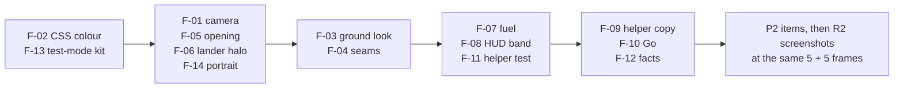

# Moon Touchdown: R1 fix list

Source: `docs/reviews/r1-review.md`. Goal: every rubric dimension at 4 or higher in R2.

- **P0:** Fix before any release. These block the gate.
- **P1:** Fix for R2. Each one stops a dimension from reaching 4.
- **P2:** Needed to hold 4 with confidence. Do these in R2 if you can.
- **P3:** Polish.
- **[TEST-MODE ONLY]** marks items that change only `?test=1` behaviour or the tests. Real players do not see these defects.
- Kit files (`src/kit/**`) are vendored. Make kit changes in `games-kit/src`, then run `pnpm kit:sync` here. Do not edit `src/kit/` in this repo.

## P0

### F-01 Keep the goal, the touchdown marker and the ground under the lander in frame

- **Files:** `src/scene/moonScene.ts` (`updateCamera`), new screen overlay in `src/hud.ts` or `src/main.ts`.
- **Defect:** At 363 m, the camera looks 39.5° down (half FOV 24°). The ground under the lander is 34° below the frame centre, so the ring, the marker and the beacon are off-screen until about 60 to 80 m.
- **Fix:**
  1. Above about 80 m, use a steep "descent cam": pitch 65° to 75°, distance from the lander 60 to 90 m. Aim at a point between the lander and the ground point under it, at about 45% of the way down. At pitch 72° and 70 m, the lander sits about 8° above the centre and its ground point about 7° below the centre. Both are in frame.
  2. Below about 80 m, blend (smoothstep over 80 to 30 m) into the present low chase cam.
  3. When the ring centre or the predicted marker is outside the frame, draw an edge arrow in the ring colour with the distance in metres. Project the world point with `camera.project()` and clamp it to the frame inset by the safe areas and the HUD.
  4. Portrait: keep the predicted marker above the bottom 30% of the frame (the controls band). See F-14.
- **Accept:** In desktop and phone screenshots at 360 m, 250 m and 18 m, the lander and the marker both show, and the ring shows or its edge arrow shows.

```text
 side view, now (363 m)                 side view, fixed (descent cam)
 cam *                                   cam *
      \  39.5° down, ±24°                    |\  72° down
       \     lander o                        | o lander (8° above centre)
        \           |                        | |
 frame   \          | 365 m                  | |  ground point in frame
 bottom   `-------- x ground point           | x (7° below centre)
          (34° below centre: OFF)
```

### F-02 Earned stars and coloured icons render in the wrong colour

- **File:** `src/game.css`.
- **Defect:** The rules `.mt-star svg`, `.mt-site-star svg`, `.mt-gauge-icon svg` and `.mt-outcome-icon svg` set `color` on the SVG element itself. The state rules (`.mt-star.is-on`, `.mt-site-star.is-on`, `.mt-gauge[data-band] .mt-gauge-icon`, `.mt-debrief[data-outcome='bumpy'] .mt-outcome-icon`) set `color` only on the parent span. The SVG does not inherit it, so earned stars stay grey (desktop-5, phone-5).
- **Fix:** Put the colour on the span only. Make the SVG inherit:

```css
.mt-star svg,
.mt-site-star svg,
.mt-gauge-icon svg,
.mt-outcome-icon svg {
  color: inherit;
}
```

  Remove `color` from the shared selectors `.mt-star, .mt-star svg`, `.mt-site-star, .mt-site-star svg`, `.mt-gauge-icon, .mt-gauge-icon svg` and `.mt-outcome-icon, .mt-outcome-icon svg`, and keep it on the span selectors.
- **Test:** In `e2e/smoke.spec.ts`, after the debrief, read `getComputedStyle(document.querySelector('.mt-star.is-on svg')).color` and expect the lemon colour from `src/kit/theme.ts`.

### F-03 Make the ground read as Moon ground, not a white tiled carpet

- **Files:** `src/scene/terrainView.ts`, `src/scene/textures.ts`, `src/scene/moonScene.ts` (lights), `src/main.ts` (`renderer.exposure`).
- **Defect:** The ground reads near-white at the descent pitch. One 150 m tile with 70 craters of similar size repeats as a carpet (desktop-2, phone-2). The albedo variation is ±7% (macro) and ±4% (craters).
- **Fix:**
  1. Calibrate the brightness: start with sun intensity 10 → 6.5, `exposure` 1 → 0.9 and `REGOLITH` `#a39b90` → `#8e877d`. Tune until flat lit ground is about 0.40 to 0.55 sRGB luminance and baked shadows are about 0.10 to 0.18.
  2. Break the repetition. In `onBeforeCompile` (both materials), sample the detail maps at 2 scales: `vUv` (tile 150 m) and `mat2(rot 37°) * vUv * 0.29` (tile about 520 m). Mix them 60/40. Fade the normal-map strength to about 30% beyond 600 m view distance.
  3. Use a power-law crater size distribution in `makeRegolithDetail` (radius 1.5 to 40 px, about 250 craters, many small and few large). Add fresh bright craters with a dark-floor/bright-rim albedo of ±12%.
  4. Raise the macro albedo variation in `TerrainView.setSource` from ±7% to about ±12%, with a second octave.
  5. Use a per-site tint: maria darker and warmer, highlands lighter (see F-24).
- **Accept:** A human reviewer cannot see the tile repeat in desktop-2 or phone-2 framing. The look gate reports a ground luminance in the band from step 1 (add this metric to the kit look gate).

## P1

### F-04 Remove the black seam dashes at the edge of the near terrain patch

- **File:** `src/scene/terrainView.ts` (`buildGrid`, skirt).
- **Defect:** The skirt triangles `(a, b, sa)` face outward only. From inside the patch, the camera sees the back faces (culled). T-junction cracks between the 30 m patch and the far mesh show the black clear colour, because the far mesh is discarded inside `uPatch`. The dashes show in desktop-2 and desktop-4, phone-3 and phone-4, and in the Firefox and WebKit picker baselines.
- **Fix:** Add the reverse winding for every skirt quad: `indices.push(a, sa, b, b, sa, sb)`. Optionally, shrink the discard rectangle by 1 m on each side, so the far mesh tucks under the patch edge.
- **Test:** In the look gate, count pixels with luminance < 0.03 below the horizon row in a frozen `?test=1` frame at the pick, 250 m and 18 m views. Expect 0.

### F-05 Opening shot: show the horizon, the sky and the Earth before the descent

- **File:** `src/scene/moonScene.ts` (`updateCamera`, phase `ready`).
- **Defect:** The ready frame looks steeply down at the ground. It shows no horizon, no sky and no Earth (desktop-2, phone-2).
- **Fix:** In `ready`, use an establishing frame. Put the camera low and behind the lander (pitch about 5° to 10° down), with the lander, the beacon, the horizon and the Earth in view. On start, swoop to the descent cam (F-01) over 1.5 s with an ease-in-out. With reduced motion, cut at once.

### F-06 Make the lander readable at altitude

- **Files:** `src/scene/moonScene.ts`, `src/scene/landerModel.ts`.
- **Defect:** The lander is about 25 px tall at 363 m (desktop-2).
- **Fix:** Cap the camera distance at about 90 m (F-01). Add a soft screen-space halo sprite (additive, `sizeAttenuation: false`, about 48 px) behind the lander. Fade it out below 60 m.

### F-07 Make fuel matter

- **Files:** `src/sim/sites.ts` (`fuel`), `src/sim/constants.ts` (`STAR_FUEL_SECONDS`, if you change it), `src/sim/flight.test.ts`, `docs/DESIGN.md` (section 4 table).
- **Defect:** Tranquility starts with 326 s of hover fuel. A helper run uses about 47 s. The call-outs never fire, and the fuel star is free.
- **Fix:**
  1. Write a test that runs the helper from seeded starts on each site's real `.bin` and records the fuel seconds used.
  2. Set each site's start fuel to "helper use + margin". Use a margin of about 90 s (site 1), 75, 60, 50, 40 and 35 s (site 6). Expect about 380 kg (Tranquility) down to about 280 kg (Hadley).
  3. Make sure the 60 s call-out fires on sites 4 to 6 in a normal helper run, and that a manual player who hovers high for 30 s or more on site 3 gets it.
- **Accept:** On sites 1 to 3 the helper lands with 30 s or more of fuel. On sites 4 to 6 the helper lands softly with 10 s or more. These are test assertions.

### F-08 Make the speed-down colour depend on height

- **Files:** `src/hud.ts` (`vsBand`, `update`), `src/main.ts` (pass the altitude), `src/game.css` (no blink while the helper is on), `src/hud.test.ts` (new).
- **Defect:** At 12 m/s the gauge is red and blinks during correct helper flight (desktop-3, phone-3).
- **Fix:** Compare speed down with a safe envelope that depends on height. Use the helper target as the envelope:

```ts
export function vsBand(down: number, height: number): Band {
  const safe = Math.max(VS_GREEN, -assistTargetVs(height)); // 1.5..12 m/s
  if (down < safe + 0.5) return 'good';
  if (down < safe + 2.5) return 'warn';
  return 'bad';
}
```

  Below 10 m, keep the strict rule (green under 2, yellow under 4). Draw the green part of the bar to the envelope value, so the child sees "fast is OK up high, slow near the ground". Add the same envelope as a band on the debrief chart (`src/graphs.ts`).

### F-09 The helper and the ring: say who steers, and show where to steer

- **Files:** `src/main.ts` (`showDebrief`, the debrief reason text), the edge arrow from F-01, `src/sim/assist.ts` (optional).
- **Defect:** The helper stops the drift only. It lands 40 to 120 m from the ring. The debrief says "Land inside the green ring for another star" with no hint.
- **Fix:**
  1. When the helper flew the engine and the ring star was missed, show: "The helper flies the engine. You steer: tilt toward the ring." Add a tilt-pad icon.
  2. During a helper flight, pulse the ring edge arrow and the tilt pad once at 200 m.
  3. Optional (see open question 7): add a "helper steers too" level for the youngest players. Steer with a position-plus-velocity loop toward the ring, capped at 10°. Award the ring star only when the child steered.

### F-10 Phone first tap: Go must not start a free fall

- **Files:** `src/main.ts` (`goBtn` handler, `onPrimary`), `index.html` (helper button label).
- **Defect:** The green Go button starts the flight with the engine off and the helper off. With no input, the lander hits the ground at about 35 m/s after about 17 s.
- **Fix:** Make Go start with the helper on until the player has 1 soft landing without the helper. Change the ready tip to show the slider icon with "take over". Give the helper button a short visible label ("Help") and a one-time pulse on the first ready screen.

### F-11 Prove that the helper is fair on real terrain

- **Files:** new `src/sim/helper-sites.test.ts` (read `public/data/terrain/<slug>.bin` with `node:fs`), `src/sim/assist.ts` (only if the test fails).
- **Defect:** The property test uses flat ground only. Sites 4 to 6 have steep relief, and the helper does not avoid slopes over 12°.
- **Fix:** For each of the 6 sites, run 50 seeds of `startConditions` with the helper on. Assert a soft landing on every run. If a slope bump happens, add slope avoidance: when the predictor reports `slope >= LIMITS.slope` below 60 m, lean the helper toward the downhill side for up to 20 m of travel.

### F-12 Correct the history facts

- **Files:** `src/sim/sites.ts` (Hadley fact), `README.md` line 9, `docs/DESIGN.md` line 56.
- **Fix:**
  - Hadley: "In July 1971 people drove a car on the Moon for the first time, here beside Hadley Rille: a winding channel about 1 to 1.5 km wide."
  - README and DESIGN: replace "about a minute of margin" with "The first crew heard the '30 seconds' fuel call just before they touched down."

### F-13 [TEST-MODE ONLY] Frozen animations leave the debrief, the stars and the call-out at opacity 0

- **Files:** `games-kit/src/styles.css` (test-mode block), then `pnpm kit:sync`. Interim fix in `src/game.css`. Add checks to `e2e/smoke.spec.ts`.
- **Defect:** `html.g499-test * { animation-play-state: paused }` holds each animation at its first keyframe. `mt-rise` and `mt-pop` start at `opacity: 0`, so the card, the earned stars and the call-out stay invisible. `toBeVisible()` still passes, because it does not check opacity.
- **Fix (kit):** Replace the paused rule with `animation: none !important;` inside `html.g499-test`. Do this in the kit, so every game gets the end state.
- **Interim (game):** `html.g499-test .mt-debrief-card, html.g499-test .mt-star.is-on, html.g499-test .mt-callout { animation: none; }`.
- **Test:** Assert `getComputedStyle(card).opacity === '1'` for `#debrief .mt-debrief-card` and for one `.mt-star.is-on`.

### F-14 Portrait: the ring hides behind the helper button

- **Files:** `src/scene/moonScene.ts` (portrait framing), `src/game.css` (portrait helper button).
- **Defect:** In portrait, the touchdown point sits at the bottom centre, under the 80 px helper button (phone-4).
- **Fix:** In portrait, aim the camera so the predicted marker stays above the bottom 30% of the frame (F-01 step 4). Alternatively, move the helper button up into the gap above the slider and the pad (`bottom: calc(22px + 168px + 16px + safe-bottom)`).

## P2

### F-15 "Helper" badge is hard to read on bright ground

- **File:** `src/game.css` (`.mt-badge`).
- **Fix:** Use a solid dark backing: `background: rgba(10, 12, 32, 0.78); box-shadow: inset 0 0 0 2px var(--g499-mint);`.

### F-16 The ready tip overlaps the throttle slider in portrait

- **File:** `src/game.css` (`@media (orientation: portrait) and (max-width: 719px) .mt-ready`).
- **Fix:** Use `bottom: calc(min(44vh, 280px) + 40px + var(--g499-safe-bottom))`, so the tip sits above the slider top (phone-2).

### F-17 Phone picker: the drawer button overlaps the card, and "How to fly" is below the fold

- **Files:** `games-kit/src/styles.css` (`.g499-overlay` on 719 px or less), then `pnpm kit:sync`. `src/game.css` (`.mt-site` on short screens).
- **Fix:**
  1. On phones, give `.g499-overlay` a top padding of `calc(var(--g499-touch) + 16px + var(--g499-safe-top))`.
  2. Below 760 px height, use `.mt-site { min-height: 120px }` and an emblem of 52 px.
  3. Alternatively, move "How to fly" into the card header as a 56 px icon button on the left.

### F-18 The Earth is cut off at the top and hidden behind the HUD in low flight

- **File:** `src/scene/sky.ts`.
- **Fix:** Lower the elevation from 9° to about 3.5°, so it sits in the clear band between the horizon and the HUD at the low chase pitch (about 14° down). Keep the azimuth away from the HUD columns (desktop-4, phone-4). Update DESIGN section 5 ("about 9° up").

### F-19 Terrain provenance cannot be reproduced

- **Files:** `scripts/terrain/fetch.py`, `scripts/terrain/SOURCE.md`, `public/data/terrain/sites.json`.
- **Defect:** The script does not apply the documented column Gaussian (σ 1.6 px). It does not write the `processing` field. Its header says "LDEM_1024, 30 m".
- **Fix:**
  1. Add the Gaussian step (numpy convolution on columns, σ 1.6 px) before the 0.5 m quantisation.
  2. Write `processing` and a `sha256` per `.bin` into `sites.json`.
  3. Fix the header comment. List `numpy` as the only dependency in `SOURCE.md`.
  4. Re-run the script and confirm that the hashes match the committed files. If they do not match, commit the regenerated files.

### F-20 Shared play: give parents more to talk about

- **Files:** `src/sim/sites.ts` (`facts: string[]`, `talk: string`), new `src/moonMap.ts` (original SVG Moon disc drawn in code, site dot from `lat`/`lon`), `src/main.ts`, `index.html` (debrief and picker), `src/graphs.ts`.
- **Fix:**
  1. Show a small Moon map with the site dot on the picker card and the debrief.
  2. Add a "real ground" line: "This ground is real. A laser on a spacecraft measured every hill."
  3. Add a "you vs the real crew" line, for example "The first crew touched down at about 0.5 m/s. You: 1.4 m/s."
  4. Use 2 or 3 facts per site, and rotate them per run.
  5. Add one "Talk about it" question per site for the parent, for example "Why does the lander need only a small push here?"

### F-21 A touchdown cue under the lander

- **File:** `src/scene/moonScene.ts`.
- **Defect:** At a 12° sun, the real shadow falls about 4.7 × height to the west, so it is off-screen until the last metres.
- **Fix:** Below 40 m, add a soft ground glow under the lander (the engine light already exists; add a faint additive decal). It grows and sharpens as the height drops. Say in DESIGN that it is a visual aid.

### F-22 A helper icon and label that children understand

- **Files:** `src/icons.ts` (`assist`), `index.html`.
- **Fix:** Draw a lander with a small hand or wings under it. Add a visible label under the button ("Help"). Keep `aria-pressed`.

### F-23 Progression honesty and a reason to replay

- **Files:** `src/progress.ts` (schema v2 with a migration from v1 in `sanitizeProgress`), `src/main.ts` (`renderPicker`, `showDebrief`), `src/scene/moonScene.ts`.
- **Fix:**
  1. Store `helped: boolean` with the best stars. Show a small helper mark on the picker stars.
  2. Store the best run's trace (120 points or fewer, under the `g499:` key) and draw it as a faint ghost trail on "Again".

### F-24 Make each site look different

- **Files:** `src/sim/sites.ts` (look parameters), `src/scene/terrainView.ts`.
- **Fix:** Give each site a regolith tint, a crater density and a crater size scale. Maria (Tranquility, Storms) are darker with fewer large craters. Highlands (Fra Mauro, Descartes) are lighter with more craters. The Taurus-Littrow floor is darker under bright massifs.

### F-25 [TEST-MODE ONLY] Wider e2e coverage

- **File:** `e2e/smoke.spec.ts`.
- **Fix:** Parameterise the helper round over all 6 sites. Unlock them with `localStorage` progress before load. Add a portrait phone screenshot at 250 m with a mask for dust, and assert the touchdown marker is in frame through a test-API field `markerOnScreen`.

### F-26 Slider jumps on first touch

- **File:** `src/input/devices.ts` (`moveSlider`).
- **Defect:** The slider is absolute. A tap in the middle gives lever 0.5, which is about 31% throttle, and the lander climbs.
- **Fix:** Make the slider relative: on `pointerdown`, store the start Y and the current lever. On `pointermove`, change the lever by the drag distance. Keep "tap on the knob" as a no-op.

## P3

### F-27 The rail title truncates to "MOON TOUCHD…"

- **Files:** `games-kit/src/shell.ts` and `menu.ts` (add an optional `shortTitle`), then `pnpm kit:sync`. `src/main.ts` (`shortTitle: 'Moon'`). Or, in the kit, allow 3 lines at 10 px.

### F-28 The engine hum is too low for phone speakers

- **File:** `src/sound.ts` (`engine`).
- **Fix:** Add a second, quieter layer at 3 times the frequency (156 to 234 Hz, volume × 0.4). Add a soft noise "hiss" through the kit `whoosh` at a low rate. Keep the volume calm.

### F-29 Clearer keys for tilt away and toward

- **Files:** `src/input/mapping.ts` (`KEYS`), `index.html` (help card), `README.md`.
- **Fix:** Drop E/Q from the help text (keep them working). Show "W/S engine · arrow keys or I J K L tilt". Move throttle off ↑/↓, so the arrows tilt in 4 directions.

### F-30 Complete the "Honest simplifications"

- **File:** `docs/DESIGN.md` section 9.
- **Fix:** Add these points:
  - The real engine throttled from about 10% to 60%, plus a fixed full setting. The game allows 10% to 100%.
  - The dry mass is a game value. The real lander was heavier at touchdown, with hover at about 25 to 30% throttle.
  - The real manual attitude rates were slower (about 20°/s).
  - The fuel seconds use the current mass (about 9% conservative).

### F-31 "Clear data" is below the fold on a 720 px desktop rail

- **File:** `games-kit/src/styles.css` (rail), then `pnpm kit:sync`.
- **Fix:** Below 780 px height, reduce the rail item height to 56 px (minimum target) and the gap to 4 px, so all 11 items fit.

### F-32 Haptic touchdown (Android)

- **File:** `src/main.ts` (`onTouchdown`).
- **Fix:** Call `navigator.vibrate?.(soft ? 30 : [40, 60, 40])` when touch controls are on, sound is not muted and reduced motion is off. It makes no network use.

## Dimension → items needed for a score of 4 or higher

| Dimension | Now | Must fix | Should fix |
| --- | --- | --- | --- |
| Core loop & fun | 3 | F-01, F-07, F-09 | F-23 |
| First-run & onboarding | 3 | F-05, F-10, F-22 | F-16, F-17 |
| Controls & game feel | 3 | F-26, plus a human playtest of the lever and pad | F-28, F-29, F-32 |
| Difficulty & fairness | 3 | F-07, F-08, F-09, F-11 | F-21 |
| Progression & retention | 3 | F-02, F-07 | F-23, F-24 |
| Shared play / fact cards | 3 | F-12, F-20 | F-30 |
| Visual direction & audio | 2 | F-03, F-04, F-05, F-06 | F-18, F-21, F-24, F-28 |
| Clarity & feedback | 2 | F-01, F-02, F-08, F-15 | F-14, F-21 |
| Kids UX, accessibility & phones | 3 | F-14, F-16, F-17 | F-22, F-27, F-31 |
| Technical quality & tests | 4 | Keep at 4: F-13, F-19 | F-11, F-25 |

## Order of work



Do F-02 and F-13 first. They are small, and they make the R2 screenshots honest.

## F1 changes

Fix round F1 was done by editing files only. Nothing ran in this round (no typecheck, lint, unit tests, build or e2e). The operator runs them next. The visual baselines change, so run `pnpm e2e:update` after a human checks the new frames.

| Id | Status | Note |
| --- | --- | --- |
| F-01 | DONE | Descent cam above 80 m (70°, 60-90 m), smoothstep blend to the low chase cam from 80 m to 30 m, ground point held in frame. Edge arrows for the ring (mint, metres) and the marker (`src/edgeArrows.ts`). Screenshot check is still to do. |
| F-02 | DONE | Colour only on the spans, SVGs inherit. e2e checks the earned-star colour (lemon). |
| F-03 | PARTIAL | Sun 6.5, exposure 0.9, regolith `#8e877d`, 2-scale rotated detail sampling, normal fade beyond 600 m, power-law craters with fresh craters (±12%), macro albedo ±12% in 3 octaves. The luminance metric in the kit look gate is not added (kit). The brightness is not measured yet. |
| F-04 | PARTIAL | Skirt has both windings, discard rect 1 m inside the patch. The black-pixel count in the kit look gate is not added (kit). |
| F-05 | DONE | Establishing shot toward the Earth; 1.5 s ease-in-out swoop; cut with reduced motion. Beacon reaches up to 85% of the start height in the ready shot. |
| F-06 | DONE | Distance capped at 90 m; additive 52 px screen-space halo that fades out from 90 m to 40 m. |
| F-07 | DONE | Fuel 370/330/300/270/265/275 kg (estimated from the helper's fuel use + margin). `src/sim/helper-sites.test.ts` asserts the fuel floors, the 60 s call-out on sites 4-6 (75% of runs) and the site-3 high hover. It prints the fuel used per site for re-tuning. |
| F-08 | DONE | `vsBand(down, height)` with the helper envelope, strict below 10 m, bar green to the envelope, no blink with the helper, envelope band on the chart. Tests in `src/hud.test.ts`. |
| F-09 | PARTIAL | Helped debrief copy with a tilt icon, ring arrow and tilt pad pulse once at 200 m. The optional "helper steers too" level is not done (open question 7). |
| F-10 | DONE | Go, tap and tilt-only starts use the helper until the first unhelped soft landing (`progress.solo`). Ready tip "Help is on, slide to take over". Visible "Help" label, one-time pulse. |
| F-11 | DONE | Test runs 16 seeds per site on the real `.bin`. `assist.ts` is unchanged until the test result is known. |
| F-12 | DONE | Hadley fact, README and DESIGN corrected. |
| F-13 | PARTIAL | Game-local `animation: none` for the card, earned stars and call-out in test mode; e2e opacity checks. The kit rule is not changed (kit). |
| F-14 | DONE | Portrait aims lower so the ground point and marker stay above the bottom 30%. |
| F-15 | DONE | Solid dark badge with a mint inset ring. |
| F-16 | DONE | Portrait ready tip sits above the slider top. |
| F-17 | PARTIAL | Game-local overlay top padding on phones and smaller site cards below 760 px height. The kit overlay rule is not changed. |
| F-18 | DONE | Earth at 3.5° up, azimuth -0.18 rad (left of the HUD columns). |
| F-19 | SKIPPED | The operator handles the terrain script. |
| F-20 | DONE | `src/moonMap.ts` map on the picker and the debrief, "real ground" line, you-vs-crew line, 2-3 rotating facts and a "Talk about it" question per site. |
| F-21 | DONE | Warm additive ground glow below 40 m, aligned to the slope. DESIGN says it is a visual aid. |
| F-22 | DONE | New icon (lander in a cupped hand) and the visible "Help" label. `aria-pressed` kept. |
| F-23 | PARTIAL | Progress schema v2 (`helped`, `solo`) with a v1 migration and tests; helper mark on the picker stars. The ghost trail of the best run is not done (optional). |
| F-24 | DONE | Per-site regolith, fresh-slope colour, crater density and crater size in `SITES[].look`. |
| F-25 | SKIPPED | Optional. The test state now has `ringOnScreen` and `markerOnScreen` for a later e2e. |
| F-26 | DONE | Relative slider: the lever moves by the drag distance; a tap is a no-op. |
| F-27 | DONE | Game-local rail title override (9 px, no letter spacing, whole words) so "Moon Touchdown" fits on 2 lines. |
| F-28 | DONE | Second hum layer at 3× the pitch (× 0.4 volume) and a soft kit whoosh hiss at 30% throttle or more. |
| F-29 | DONE | W/S engine only; arrows tilt in 4 directions; help card and README updated; E/Q and A/D still work. |
| F-30 | DONE | Four points added to DESIGN section 9. |
| F-31 | SKIPPED | Kit change. |
| F-32 | DONE | `navigator.vibrate` on touchdown with touch controls on, sound on, reduced motion off and not in test mode. |

## F2 fuel

Goal: the fuel star is earned, not free, and the game stays kind. This round edited files only. Nothing ran. The operator runs `pnpm test` and reads the 3 tables that `src/sim/helper-sites.test.ts` prints.

### Input (measured after F1, helper, 16 seeds per site, real terrain)

| Site | Start fuel | Helper used | Helper left |
| --- | --- | --- | --- |
| tranquility | 370 kg | 51-59 s | 91-98 s |
| storms | 330 kg | 56-63 s | 71-79 s |
| fra-mauro | 300 kg | 60-68 s | 55-62 s |
| descartes | 270 kg | 65-73 s | 39-46 s |
| taurus-littrow | 265 kg | 69-77 s | 32-41 s |
| hadley | 275 kg | 73-82 s | 31-40 s |

The fuel star (30 s) was free on every site.

### Hand calculation

1. Hover flow = m · g / (Isp · g0) = m · 1.62 / 3050. At 4,480 kg that is about 2.38 kg/s. At 4,670 kg it is about 2.48 kg/s. (The brief said about 2.76 kg/s. The constants give 2.38 to 2.48 kg/s.)
2. Fuel seconds = f · 1882.7 / (4300 + f). The inverse is f = 4300 · s / (1882.7 − s).
3. Convert the worst-seed "left" to kg. Helper use (kg) = start fuel − that value.
4. The helper commands accelerations, so its fuel use scales with the mean mass. A lighter lander uses about 1% to 4% less fuel.
5. New start fuel = scaled worst-seed use + about 31 kg (about 13.5 s of hover at the end).
6. Spread check: the best seed keeps the old spread (17 to 21 kg), so it leaves about 21 to 23 s. That is below 25 s.

### Result (hand calculation; replace with the measured numbers)

| Site | Start fuel | Full tank | Helper left (calc) | Efficient pilot left (calc) |
| --- | --- | --- | --- | --- |
| tranquility | 177 kg | 74.4 s | 13.5-21 s | about 40 s |
| storms | 188 kg | 78.9 s | 13.5-22 s | about 42 s |
| fra-mauro | 198 kg | 82.9 s | 13.5-21 s | about 44 s |
| descartes | 208 kg | 86.9 s | 13.5-21 s | about 45 s |
| taurus-littrow | 220 kg | 91.6 s | 13.5-23 s | about 47 s |
| hadley | 232 kg | 96.4 s | 13.5-23 s | about 50 s |

### Changes

| Item | Status | Note |
| --- | --- | --- |
| Start fuel | DONE | `src/sim/sites.ts`: 177/188/198/208/220/232 kg. |
| Test (a) helper | DONE | Every site, 16 seeds: soft, fuel left in [10, 25) s, no fuel star, never dry, 60 s call-out in 75% of runs or more. Prints a table. |
| Test (b) efficient pilot | DONE | Uses only HUD values. Engine off to 20 m/s, hold 20 m/s, constant-deceleration brake at 60% of the spare thrust to 1.6 m/s at 6 m, then 1.0 m/s. Leans against the drift only while the engine pushes. Sites 1-3: soft and 30 s or more. Sites 4-6: printed only. |
| Test (c) takeover | DONE | Sites 1-3, 4 seeds, 6 manual styles (efficient for 4/12/20 s, hover for 10/25 s, engine off for 8 s), then the helper. When fuel ≥ `assistFuelNeed`: soft and never dry. At least 8 such states. Prints a table. |
| Helper fuel need | DONE | `assistFuelNeed(height, vy, hs, hoverThrottle)` in `src/sim/assist.ts`. It uses the vertical momentum identity plus the profile time, × 1.05 + 2 s. It returns Infinity when full thrust cannot stop the fall in half the height. A flat-ground property test checks that it covers the helper's use. |
| What-if run | DONE | `flyHelper(terrain, start or state)` and `Flight.fromState` in `src/sim/flight.ts`. |
| Low-fuel prompt | DONE | Manual flight below 15 s (`LOW_FUEL_PROMPT_SECONDS`): one prompt per run, "Low fuel: tap Help to land safely", with the helper icon. The Help button pulses. The 60 s and 30 s call-outs now show the fuel icon. |
| Out of fuel | DONE | `fuelOutAdvice(height)` in `src/sim/judge.ts`. Above 20 m: "Out of fuel up high: start braking a bit later next time." plus a tip. Near the ground: "So close!" plus a tip. A test checks that it uses no shaming words. |
| HUD star tick | DONE | Filled star tick at 30 s on the fuel bar, plain tick at 60 s. Below 30 s the bar is red and the star tick fades. |
| Debrief | DONE | "Fuel left: N s (star at 30 s)" with a star that fills when earned. "Helper would have left ~M s" (what-if helper run from the same start) when the child flew and missed the ring or fuel star. A helped run that missed the fuel star says the helper is careful and uses a lot of fuel. |
| Docs | DONE | DESIGN (fuel section, site table, per-site fuel table), README how to play, help card line. |

### To do after the run

- Copy the measured "helper left" and "pilot left" ranges into the 2 tables above and into DESIGN section 4.
- If a site's helper minimum is below 12 s, add about 2.5 kg per missing second. If its maximum is 25 s or more, remove about 2.5 kg per extra second. (Near the end of a run, 1 kg is about 0.43 s.)
- The debrief and HUD screenshots change. Run `pnpm e2e:update` after a human checks them.

## F3 changes

Source: `docs/reviews/r2-review.md` (TOP 10 and "DIMENSIONS BELOW 4"). Goal: every dimension at 4 or higher in R3. This round edited files only. Nothing ran: no typecheck, lint, unit tests, build or e2e. The operator runs them next. Kit files (`src/kit/**`) are not changed.

| # | Item | Status | Files |
| --- | --- | --- | --- |
| 1 | Low-fuel prompt from `assistFuelNeed`: pure `lowFuelPrompt` ('help' / 'brake' / null). "Brake now: slide up" (slider icon, or "hold W" key-cap) only when falling faster than the green speed. Helper fuel-out debrief line about Help, never the child. Test (c2) on every site. | DONE | `src/sim/assist.ts`, `src/sim/judge.ts`, `src/main.ts`, `src/icons.ts`, `src/sim/assist.test.ts`, `src/sim/judge.test.ts`, `src/sim/helper-sites.test.ts` |
| 2 | Debrief actions sticky at the bottom of the card on all sizes (card bg, top fade). Phones (< 720 px wide or < 500 px high) fold the chart and fact card into a "More" `details`. The chart is drawn again when "More" opens. Duplicate fuel pill removed. | DONE | `index.html`, `src/game.css`, `src/main.ts` |
| 3 | One colour language: manual-flight red = stopping limit at 75% of the spare thrust (cap 25 m/s); yellow = fast but stoppable. Helper bands unchanged. Efficient pilot flies by the HUD and must never show red. Tips: "fall fast in the yellow up high, then brake hard before the red". | DONE | `src/hud.ts`, `src/hud.test.ts`, `src/sim/judge.ts`, `src/sim/helper-sites.test.ts`, `README.md` |
| 4 | Edge arrow: the circle is centred on the clamped point; label on the inner side (`is-label-left`); insets ≥ radius + 8 px, top below the measured HUD band (and the phone drawer button). `ringArrowOnScreen` in the test state. | DONE | `src/edgeArrows.ts`, `src/edgeArrows.test.ts`, `src/game.css`, `src/main.ts` |
| 5 | `flightPose`: top limit (lander and its top 8 px below the HUD band), bottom limit (ground point above the controls band), distance grows when both do not fit. The page measures the HUD band (ResizeObserver) and passes it with `setFrameInsets`. `landerOnScreen` and `landerPx` in the test state. | DONE | `src/scene/moonScene.ts`, `src/main.ts` |
| 6 | Helper flight: the 30 s call-out is lemon "Fuel star gone. Help still lands safely." (only while the helper's need is covered); the fuel bar and number stay lemon. Red stays for manual flight. | DONE | `src/main.ts`, `src/game.css`, `src/hud.ts` (comment) |
| 7 | "Ring + thrifty" pilot (lean toward the ring, at most 12°, only while the engine pushes, flies by the HUD bands, plans its fall speed for reach without spending a 34 s fuel reserve). Asserts 3 stars on ≥ 1 seed per site and a median fuel left ≥ 33 s on sites 1-3. Start fuel not changed: no measurement yet. Measured tables are still to copy into DESIGN section 4 (placeholders "to measure"). | PARTIAL | `src/sim/helper-sites.test.ts`, `docs/DESIGN.md` |
| 8 | Crater cast-shadow crescents on the sun side (detail-map alpha, read from the unrotated sample only). Soft dark, sunk far horizon (outer 1.8 km). Beacon is a short pillar in flight (14-70 m). Marker ≥ 30 px across. Ground glow from 50 m, brighter (visible at 20-40 m). Soft contact shadow below 20 m, skipped on the low tier. | DONE | `src/scene/textures.ts`, `src/scene/textures.test.ts`, `src/scene/terrainView.ts`, `src/scene/moonScene.ts` |
| 9 | Ready shot: a low hero shot 9 m below and 70 m (portrait) / 100 m (landscape) behind the lander, 2° down; the lander sits in the upper middle, above Go. The Earth sits to its left. On portrait phones Go moves low in the middle, above the Help button (short screens such as 393 × 659 had no room between the HUD and Go). e2e checks Go does not cover the lander. | DONE | `src/scene/moonScene.ts`, `src/game.css`, `e2e/smoke.spec.ts` |
| 10 | Hover 15.5-16.8 %, a quarter of the way up (DESIGN, mapping comment). Ready tip shows a "W" key-cap when the touch pad is off. Descartes rover "about 17 km/h". Friendly face: round eyes with a glint and a small smile (the square door is gone). | DONE | `docs/DESIGN.md`, `src/input/mapping.ts`, `index.html`, `src/game.css`, `src/sim/sites.ts`, `src/scene/landerModel.ts` |
| 11 | Game-feel proxy: noisy, slow novice (0.4 s delay, ±15% lever noise, new wobble every 0.5 s) takes over from Help at 150 m; ≥ 80% soft of 20 seeds per site; table printed. **A human playtest is still recommended** (phone and keyboard: can a first-timer take over from Help and land softly in 3 tries; does the lever feel right near hover?). | DONE (proxy) | `src/sim/helper-sites.test.ts` |
| 12 | e2e in every project: ring or ring arrow on screen at every flight sample; lander on screen below the HUD band below 60 m (fine steps); Go does not cover the lander; Again / Next / Sites fully in the viewport; no fuel pill. New prompt-timing test with `?test=1&fuel=<kg>` (test mode only): tank 3 s above the helper need, fly by hand, expect "help" at once, tap Help, expect soft. Baselines not changed. | DONE | `e2e/smoke.spec.ts`, `src/main.ts` |

### New and changed tests

- `src/sim/assist.test.ts` (new): prompt boundaries, Infinity and empty-tank cases, property "'help' means the fuel covers the need".
- `src/sim/helper-sites.test.ts`: (b) now flies by the HUD and asserts 0 red steps on every site; (c2) Help at the "help" prompt on every site; (d) ring + thrifty pilot; (e) novice takeover. Each prints a `console.table`.
- `src/hud.test.ts`: manual bands (20 m/s at 300 m is yellow, red above the stopping limit, cap), property for the red line.
- `src/edgeArrows.test.ts`: arrow insets, property "the circle never leaves the view".
- `src/scene/textures.test.ts`: crater shadow side, shift vs sun height, range property.
- `src/sim/judge.test.ts`: helper fuel-out words, tip colour words.
- `e2e/smoke.spec.ts`: the checks in item 12 and the prompt-timing test.

### To do after the run

- Copy the tables of (b), (d) and (e) into DESIGN section 4 (replace "calc" and "to measure").
- If (d) misses 3 stars on a site, read its "distance median" and "left min": raise the start fuel about 2.5 kg per missing second only while (a) stays in [10, 25) s.
- The ready shot, flight frames, debrief and HUD screenshots change. Run `pnpm e2e:update` after a human checks them.

## F4 controls

Source: owner playtest of Catch (same input and Help pattern): "the keyboard controls didn't work, or felt like they didn't". This round edited files only. Nothing ran. The operator runs typecheck, lint, unit tests, build and e2e next. Kit files (`src/kit/**`) are not changed.

### Keyboard path audit

| Way a key got lost | Fix |
| --- | --- |
| The kit skips `preventDefault` on key repeats, so a held arrow or Space could scroll the page. | `KeyTracker` prevents the default of every flight key (repeats too) and of the Space repeat while the flight owns the keys. With a card or the drawer open, the keys stay with the page. |
| A mouse click left the focus on a rail or game button. Space then clicked that button again (for example Restart or Sites). | After a pointer click (`detail > 0`) the button lets go of the focus, unless its handler moved the focus on purpose. Keyboard activation keeps the focus. Hold-to-confirm buttons are not changed. |
| Ctrl+W, Cmd+S and Alt+arrows were read as held flight keys. | Keys with Ctrl, Cmd or Alt are not flight keys. |
| A keyup missed while the page was hidden, or under Cmd on macOS, left a key stuck. | Held keys clear on window blur, on `visibilitychange` (hidden) and on a Cmd keyup. A repeat after the focus comes back holds the key again. |
| Help turned off only on the next frame (after the key event). | An engine key turns Help off on the key event itself. The chip lights on the same event. |
| W was slow: 0.45 lever per second, about 0.6 s from off to hover. | First-press step plus a faster ramp (item 1). |
| Layout and IME. | Keys use `KeyboardEvent.code` (physical keys), so AZERTY, Dvorak and an active IME still work. Text fields and contenteditable are ignored. |

### Items

| # | Item | Status | Files |
| --- | --- | --- | --- |
| 1 | Immediate response. A new "more engine" press with the lever below 0.08 steps it to 0.08 (engine lit on that frame), then `KEY_LEVER_RATE` 0.85/s: off to hover about 0.26 s, full range about 1.08 s. The HUD throttle, plume and hum follow `flight.state.throttle` on the same frame. Tilt keys reach their command in 50 ms (`KEY_TILT_SLEW` 12/s; sticks and the pad keep 4/s). The instant tilt cue is a white ring on the HUD tilt ball and the lit arrow key cap. The sim attitude lag (`TILT_TAU` 0.25 s, 45°/s) is not changed, so the tuned helper and fuel tests stay valid: the lander leans about 3° at 100 ms and about 10° at 300 ms. | PARTIAL (the lander's own lean at 100 ms is small; the cue is instant) | `src/input/mapping.ts`, `src/hud.ts`, `index.html`, `src/game.css` |
| 2 | The engine changes hands, visibly. Player engine input while Help flies turns Help off at once (on the key event for keys, on the frame for touch and stick). The Help button and the rail item un-press. The toast "You fly now" (lander icon, `role="status"`, `aria-live="polite"`) shows. Help on shows "Help flies the engine". Design kept: tilt input does not turn Help off. Help keeps the engine and the player steers, and the chip shows "Help" for the engine with the arrow caps for tilt. Help never moves the lever after a player engine press. Pure logic: `handover`, `toastFor`. | DONE | `src/input/control.ts`, `src/main.ts`, `index.html`, `src/game.css` |
| 3 | HUD input chip: the first item of the HUD row (top left of the stage, right of the rail; right of the drawer button on phones). It shows the device icon (keyboard, touch, gamepad) and who flies the engine ("Help" mint pill or "You"). Keyboard: W and S caps plus 4 arrow caps that fill, outline and sink while held. Touch or gamepad: slider and pad glyphs that light on input. The text is for screen readers. No motion with reduced motion. It replaces the old "Help" badge (the toast uses its place). | DONE | `src/inputChip.ts`, `src/input/control.ts` (`chipView`), `src/icons.ts` (keyboard, gamepad, slider, pad), `index.html`, `src/game.css`, `src/main.ts` |
| 4 | Key prompts. With the touch pad off, the ready tip says "Press W for engine, ← → arrows to steer, Space for Help" with key caps (new players and solo players). The touch tip stays "Help is on, slide to take over". The How to fly card uses the same key caps (W, S, arrows, Space, P, M). One-time key hint in the first manual flight (not after a solo landing): no flight key for 3 s after Help turns off shows "Press W for engine, ← → to steer, Space for Help" as a prompt. It waits while a low-fuel prompt shows. | DONE | `index.html`, `src/game.css`, `src/main.ts`, `src/input/control.ts` (`keyHintDue`) |
| 5 | Test API in `state()`: `lastInputSource`, `lastInputAgeMs`, `heldKeys`, `litKeys`, `lever` (the helper's lever while Help flies), `tiltX` and `tiltZ` (player command, degrees), `landerTilt` `{ x, z, deg }` (the real tilt the model is drawn with, degrees), plus `time`, `vx`, `posX`, `toast`, `keyHintShown`. | DONE | `src/main.ts` |
| 6 | Unit tests (listed below). | DONE | `src/input/control.test.ts`, `src/input/mapping.test.ts` |
| 7 | e2e `e2e/controls.spec.ts`, desktop Chromium project, built site, `?test=1&live=1` (live clock and render loop, fixed seed, silent audio), real `keyboard.down` / `up` and real waits. It runs in about 10 s after the page loads. | DONE (not run) | `e2e/controls.spec.ts`, `playwright.config.ts` (`testMatch` adds the file) |

Docs: README (who flies, the chip) and DESIGN section 9 (key response, handover, chip, tips).

### New tests

- `src/input/control.test.ts` (new):
  - key tracker: held by code; repeats prevented; no capture with a card open; clear on blur; Cmd keyup clears; shortcuts, text fields and other keys ignored; Space repeat only; property "every held code is prevented only while captured";
  - handover: engine input while Help flies turns Help off on the same frame with "You fly now"; tilt keeps Help; the toast texts; W in a helped flight raises the throttle above the helper's on that frame (no jump down);
  - input source order and chip view (lit caps, who flies, device);
  - key hint timing (3 s) and its guards.
- `src/input/mapping.test.ts`: first W press lights the engine on the first frame, then ramps (no second step); off to hover (17%) in 0.35 s or less and the full range in 1.2 s or less; the step stays below hover; S never steps; tilt keys reach the key command in 50 ms, sticks keep the slower slew.
- `e2e/controls.spec.ts`:
  1. Pick Tranquility and check the keyboard tip has 4 key caps.
  2. Control run: Space starts with Help on, the toast says "Help flies the engine", no input for 0.9 s.
  3. Restart from the rail. The rail button lets go of the focus. Space starts again.
  4. Hold W. Within 150 ms (wall clock and `lastInputAgeMs`), check: Help is off, throttle > 0, source is 'keyboard', KeyW is held, the W cap is lit, the toast says "You fly now" and the Help button is not pressed. The lever ramps.
  5. Motion check: the vertical acceleration with W is at least 0.4 m/s² more than in the no-input Help run.
  6. Hold the left arrow for 300 ms. Check: the left cap is lit, the tilt command is negative and the tilt-ball ring shows. The lander leans left by more than 2° and vx decreases.
  7. Help on from the rail, then S: Help turns off and the toast says "You fly now".
  8. Check that `window.scrollY` is 0. No external requests, no console errors, no cookies.

### To do after the run

- Run the static checks and the unit tests, then the new e2e test alone: `pnpm build`, then `pnpm exec playwright test --config playwright.config.ts --project chromium controls.spec.ts`. The config starts `vite preview` on port 4176. `pnpm ci:local` runs it with the rest.
- The HUD (chip), the ready tip and the help card change, so the screenshot baselines change. Run `pnpm e2e:update` after a human checks the frames.
- Human playtest on a keyboard: is W at 0.85/s too fast near hover? If yes, try 0.75/s (off to hover 0.29 s, full range 1.23 s: just over the 1.2 s target).
