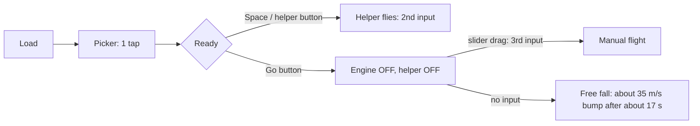

# Moon Touchdown: review gate R1

## Scope

- **What:** Moon Touchdown, standalone build (`/games/moon-touchdown/`), state on 2026-10-30.
- **Evidence level:** CODE + DOC + BUILD WALKTHROUGH (solo, automated screenshots). There was no human playtest.
- **Read:** `docs/DESIGN.md`, `README.md`, `LICENSES.md`, `scripts/terrain/SOURCE.md`, `scripts/terrain/fetch.py`, `public/data/terrain/sites.json`, `src/sim/*`, `src/main.ts`, `src/hud.ts`, `src/graphs.ts`, `src/game.css`, `src/icons.ts`, `src/sound.ts`, `src/scene/*`, `src/input/*`, `src/progress.ts`, `index.html`, `e2e/smoke.spec.ts`, and the kit test-mode and rail CSS (`src/kit/styles.css`).
- **Images opened (15):** `shots/r1/desktop-1..5`, `shots/r1/phone-1..5` (Pixel 7, software GL), and the 5 CI baselines `e2e/screenshots/{chromium,firefox,webkit,iphone,pixel}-win32/moon-touchdown.png`.
- **Rubric:** 10 dimensions, 1 to 5, weighted. The rubric text was not attached to the task. The weights below are my reading of it. "Social dynamics" (15%) is read as **shared play: parent-child play, talk-about-it value and the fact cards**. "Difficulty & fairness" means fair physics, failures that the game explains, and a gentle curve.
- **Confidence key:** H = seen in a screenshot or proved from code with numbers. M = strong inference from code. L = needs a human playtest.

## Audience and intent

- Solo family flight game for ages 7 and up, often with a parent next to the child.
- Promise: "Fly a lander down to a real Moon landing site and touch down gently." The game teaches gravity versus thrust, fuel budget and gauge reading.
- Session: one run is 50 to 90 s. The loop is pick, fly, debrief, again.
- Success for this audience:
  - The child sees the goal (the green ring) and the lander at all times.
  - The child lands softly in the first 2 minutes, with or without the helper.
  - The parent finds something true and interesting to talk about after each landing.

## Verdict

**REVISE. The game does not pass the R1 gate.**

The simulation, the judge, the predictor, the tests and the facts are strong. The player-facing layer does not match them. For most of the descent, the camera does not show the target ring, the predicted touchdown marker or the ground under the lander. The ground looks white and repeats visibly. The earned stars, which are the main reward, render grey. Fuel never runs low in normal play, so one of the three teaching goals has no effect. Do the P0 and P1 items in `FIXLIST.md`, then run R2.

## Overall

**2.85 / 5** (weighted). The foundation is about 4/5. The presentation and feedback layer is about 2/5.

## TOP 5

1. **The goal is off-screen (P0, H).** At the start (363 m), the chase camera looks 39.5° down with a half field of view of 24°. The ground under the lander is 34° below the frame centre, so it is 10° off the bottom of the frame. The ring, the predicted touchdown marker and the beacon do not show until the last tens of metres (desktop-2, desktop-3, phone-2, phone-3). On phones, the ring then sits behind the helper button (phone-4).
2. **Earned stars render grey (P0, H).** In `game.css`, `.mt-star svg` sets `color` on the SVG itself. `.mt-star.is-on` sets the lemon colour only on the parent span, so the SVG never inherits it (desktop-5, phone-5). The picker stars (`.mt-site-star`), the gauge icon bands and the bumpy outcome icon have the same bug. This is a real bug, not a test-mode artefact.
3. **The ground looks white, flat and tiled (P0/P1, H).** A 150 m decorative crater tile (`DETAIL_TILE`, 70 craters, 256 px) repeats as a uniform carpet. The surface reads near-white at the descent pitch. Thin black dashes show the seam of the near terrain patch: the patch skirt faces outward, so the camera inside the patch sees through the T-junction cracks to the black clear colour. The opening frame has no horizon, sky or Earth, and the lander is about 25 px tall.
4. **Fuel never matters (P1, H).** Tranquility starts with 326 s of hover fuel. The helper run used 47 s and landed with 279 s left. The 60 s and 30 s call-outs, the fuel star and the "fuel budget" lesson do not happen in normal play. Even Hadley (196 s of fuel) gives about 2.2 times the Δv a helper run needs.
5. **The helper and the HUD send mixed signals (P1, H).** The helper descends at 12 m/s, and the speed-down gauge shows red and blinks for about 20 s while "everything is fine" (desktop-3, phone-3). The helper stops the drift but does not steer to the ring. The helper lands 40 to 120 m from the ring (104 m in the walkthrough), yet the debrief says "Land inside the green ring for another star" and gives no hint that the child must steer. On phones, the green **Go** button starts the flight with the engine off and the helper off. With no further input, the lander hits the ground at about 35 m/s after about 17 s.

## SCORES

| # | Dimension (weight) | Score | Conf. | Evidence |
| --- | --- | --- | --- | --- |
| 1 | Core loop & fun (15%) | 3 | M | Clean 50 to 90 s loop with an "Again / Next / Sites" hook (`main.ts showDebrief`). The predictor ring is a great mechanic, but it is off-screen for most of the flight. Fuel gives no tension. With the helper, the game flies itself. |
| 2 | First-run & onboarding (10%) | 3 | M | The picker opens on load. Site 1 terrain preloads. Desktop Space starts with the helper on (good). On phones, Go is the visual call to action and leads to free fall (`goBtn` → `startFlight()` with no assist). The helper icon has no label, and its meaning is unclear to non-readers. |
| 3 | Controls & game feel (10%) | 3 | L | Good: the throttle curve puts hover at 1/3 of the lever, the relative tilt pad, smoothing, the no-jump hand-back from the helper, the gamepad. Risks: absolute slider jumps on first touch, E/Q for "away/toward" is not intuitive, the engine hum (52 to 78 Hz) is below what phone speakers play, no haptics. Feel needs a playtest. |
| 4 | Difficulty & fairness (10%) | 3 | M | The physics are fair and the judge gives kind, specific reasons (`BUMP_TEXT`). The site curve is gentle and monotonic. But: the HUD shows red during correct helper flight, the ring rule is not explained for helper users, fuel is never a factor, and nobody has proved the helper lands softly on the real terrain of sites 4 to 6 (the property test uses flat ground only). |
| 5 | Progression & retention (10%) | 3 | M | 6 real sites, 3 stars each, unlock on a soft landing, stored under `g499:`. The helper unlocks all 6 sites with no skill in about 6 minutes. The fuel star is always free, so "3 stars" means "ring star" only. There is no ghost of the best run. |
| 6 | Shared play / parent-child / fact cards (15%, reinterpreted "Social dynamics") | 3 | M | Real places, a true fact per site, the 1.62 vs 9.81 gravity card and a clear descent chart give talk value. One fact is inaccurate ("first car on the Moon", see Physics). The docs repeat a wrong history claim ("about a minute of margin"). There is no "where on the Moon" map, no "this ground is real, measured by a laser" fact, and no comparison with the real touchdown. |
| 7 | Visual direction & audio (10%) | 2 | H | The lander is charming: gold foil, a cabin with a friendly face, springy legs, a plume. The terrain is washed out and tiled. Seam dashes show. In the opening frame, there is no horizon, sky or Earth. In low flight, the Earth is cut off at the frame top and hidden behind the HUD (desktop-4, phone-4). The long sun shadow of the lander falls about 4.7 × height to the west, so it is off-screen until the last metres. The audio is calm but thin. |
| 8 | Clarity & feedback (10%) | 2 | H | The HUD gauges are well designed (bands, drift arrow, tilt ball, hover mark). But the goal and the touchdown marker are not visible, the speed colours contradict the helper, the earned stars look unearned, and the "Helper" badge has low contrast on the bright ground (desktop-3, phone-3). |
| 9 | Kids UX, accessibility & phones (5%) | 3 | H | Targets are 56 px or more, safe-area insets are used, menus are on the left, reduced motion is honoured, pause works on visibility change. Defects: the drawer button overlaps the picker card corner (iphone baseline, phone-1). "How to fly" is below the fold on iPhone. The ready tip overlaps the throttle slider in portrait (phone-2). The ring is under the helper button in portrait (phone-4). The rail title truncates to "MOON TOUCHD…". |
| 10 | Technical quality & tests (5%) | 4 | H | Pure sim with a fixed step, seeded determinism, property tests (helper, predictor vs full sim), 151 unit tests, 48 e2e passed. Gaps: in test mode the debrief card and the stars sit at opacity 0, but `toBeVisible()` still passes. `fetch.py` does not do the Gaussian smoothing that `SOURCE.md` documents, and its header says "LDEM_1024, 30 m". The e2e round covers Tranquility only. |

**Weighted overall:** 0.15·3 + 0.10·3 + 0.10·3 + 0.10·3 + 0.10·3 + 0.15·3 + 0.10·2 + 0.10·2 + 0.05·3 + 0.05·4 = **2.85**.

## HEURISTICS: RISK / FAIL

| Heuristic | Result | Note |
| --- | --- | --- |
| The goal is visible during play | **FAIL** | Ring and marker are off the frame bottom above about 60 to 80 m (desktop-2, -3, phone-2, -3). |
| The reward is visible and reads as earned | **FAIL** | Stars render grey (CSS colour inheritance bug). |
| One colour language | **FAIL** | Red speed during correct helper flight. Green ring, green "good" band and green Go button mean three different things. |
| Resources create decisions | **FAIL** | Fuel ends at 85% (Tranquility) and about 50% or more (Hadley) of the start value. |
| The first tap leads to success | RISK | Phone Go starts with the engine off. The safe path (helper button) is unlabelled and visually weaker. |
| Failures are explained | PASS | Up to 2 kind reasons, with numbers on the debrief pills. |
| Fair, deterministic physics | PASS | Fixed step, exact free fall, rocket equation within 0.1%. |
| Assisted mode is fair on every site | RISK | Not tested on real terrain. The helper does not avoid slopes over 12°. |
| Visual novelty over 6 sites | RISK | The same detail tile and colour on every site. Only the large relief changes. |
| Playable with no reading | RISK | Icons carry most meaning. The helper icon, the ready tip and the debrief reasons need reading. |
| The test oracle matches what users see | RISK | Opacity-0 cards pass `toBeVisible()` in test mode. |
| Facts are true | RISK | Hadley "first car" (a robot rover drove in 1970). README/DESIGN "about a minute of margin". |
| Session length fits kids | PASS | 50 to 90 s per run. |
| Pause and interruption | PASS | P, Esc, Start, drawer, `visibilitychange`. |
| Performance on a mid phone | RISK | Frame budget passed on a host GPU (Chromium). There is no real-device data. The bake runs about 4.6 M terrain samples per site load on the main thread. |
| Privacy and CSP | PASS | Same-origin terrain fetch only. CSP meta is present. Storage is `g499:` only. |

## FIRST-RUN TIMING (estimated from code)

| Step | Desktop | Phone (touch pad on) |
| --- | --- | --- |
| Load → picker visible | 0 inputs (auto). Site 1 terrain and the shadow bake load in the background. | 0 inputs |
| Pick Tranquility | 1 click | 1 tap |
| Ready screen | Go button (96 px, breathing), "Space" not shown | Go button, helper button (80 px, dark, no label), slider, pad |
| First throttle | **2nd input**: Space starts with the helper on, and the helper throttles at once. Or hold W. | **2nd input** if the child taps the helper button. **3rd input** on the likely path (Go, then a slider drag). |
| Trap path | Click Go, then no keys. | Tap Go, then no input. |
| Trap result | Free fall from about 363 m at 7.8 m/s. Touchdown at about 35 m/s after about 17 s, "Bumpy landing". | Same |
| Time to first throttle | About 4 to 8 s | About 6 to 15 s |
| Time to first debrief | About 55 to 60 s with the helper (52 s flight + 1.6 s delay) | Same |

## WHAT'S WORKING

- **Physics model:** It is clean, pure, documented and honest. Section 9 "Honest simplifications" in DESIGN.md is excellent practice.
- **Predictor:** The coloured touchdown marker with a ghost trail, checked against the full sim by a property test, is the best teaching tool in the game. It needs to be on screen.
- **Kind failure:** "The legs went boing", a hop animation, a gentle sound, at most 2 specific tips. There is no violence and no crash.
- **Debrief chart:** Height and speed-down lines, different line styles plus colours, a green safe band and a touchdown dot. A parent can explain the flare from it.
- **Lander art:** It is original and toy-like, with a friendly face. It reads well when close (desktop-4, phone-4).
- **Controls:** The lever curve puts hover at about 1/3 of the travel. The pad is relative. The helper hands back control with no jump. Keyboard, touch and gamepad all work.
- **Real data:** True-scale LOLA heights, correct site coordinates, provenance and licence notes.
- **Engineering:** Determinism, seeded starts, test API, tier-based LOD, disposal, CSP, offline.

## COMPARABLES (generic genre only)

| Comparable | What it does well | Lesson for this game |
| --- | --- | --- |
| Classic 1979-era vector lunar-landing arcade games | The lander and the landing pad are always in one frame. The camera zooms in near the ground. | Frame the lander and the target together. Zoom by altitude. |
| Modern physics-sandbox rocketry games (landing missions) | A navball, a target marker and an off-screen marker arrow | Add an edge arrow to the ring when it is off-screen. |
| Flight-sim landing tutorials | Step-by-step "now do this" cues and a glide-slope band | Make the speed band height-aware ("fast is OK high up, slow near the ground"). |
| One-thumb mobile lander and hover games | One control at first, more later | Start the first run with the helper on. Add manual control as a step. |
| Kids' science apps with a "fact after the level" pattern | One short, vivid fact plus a picture or map | Add a small Moon map with the site dot. Add a real-vs-you comparison line. |

## PHYSICS REALISM

Reference values are standard published figures for the Moon and for the 1960s and 1970s crewed lunar descent engine. Confidence is H unless marked.

| Item | Game | Real / check | Result |
| --- | --- | --- | --- |
| Lunar gravity | 1.62 m/s² | 1.62 m/s² (mean surface value about 1.62 to 1.625) | **PASS** |
| Earth g0 | 9.80665 | Standard gravity | **PASS** |
| Isp | 311 s → c = 3050 m/s | Descent engine about 311 s (vacuum), with some sources at 305 s | **PASS** |
| Full thrust | 45,000 N | About 45,040 N (10,125 lbf) | **PASS** |
| Mass flow | F/(Isp·g0) = 14.75 kg/s at full | About 14.7 kg/s at full thrust | **PASS** |
| Throttle range | 0, or 10% to 100% continuous | Real: about 10% to 60% continuous, plus a fixed full-thrust setting. The middle band was not used. | **ISSUE (minor):** add to "Honest simplifications". |
| Dry mass, fuel | 4,300 kg, 500 to 900 kg | Real lander at touchdown was about 7,000 to 7,300 kg, with hover throttle about 25 to 30%. Game hover is 17 to 19%. | **ISSUE (minor):** the values are scaled and DESIGN says so for fuel. State that the dry mass is also a game value. |
| Hover time shown | Tranquility 326 s, Hadley 196 s | 900 / (5200·1.62/3050) = 325.8 s ✓. 500 / (4800·1.62/3050) = 196 s ✓. | **PASS** (maths). The display uses the current mass, so it is about 9% conservative against the log form (357 s). That is OK. |
| Rocket equation | Midpoint mass per step, test within 0.1% | Δv Tranquility = 3050·ln(5200/4300) = 579 m/s. Hadley = 335 m/s. | **PASS.** Design ISSUE: a helper run needs about 95 m/s (Tranquility) to about 150 m/s (Hadley), which is a 2.2 to 6 times margin. See FIXLIST F-07. |
| Thrust-to-weight | 5.3 (full, Tranquility) | Real at touchdown was about 3.8. | PASS for a game (more authority, more forgiving). |
| Tilt limits | 30° max, 45°/s, τ = 0.25 s | Real manual attitude rates were about 20°/s at most (M). | **PASS** as a game choice. Note it in DESIGN. |
| Integrator | Constant acceleration per step, dt = 1/60 | Exact for free fall. The attitude update is exact (exp form). Rates are not stiff. | **PASS** |
| Footpad contact | 4 pads, rotated by the tilt, bilinear ground. The first pad at or below 0 ends the flight. | Overshoot is at most v·dt = 0.2 m at 12 m/s. The vs error is less than g·dt = 0.03 m/s. The engine bell (−1.77 m) is always above the lowest pad. | **PASS.** Slope is sampled at the centre (±3 m), not under each pad. That is acceptable. |
| Landing limits | vs < 2.0, hs < 1.2, tilt < 10°, slope < 12° | Real lander design envelope: vertical about 3 m/s (10 ft/s), horizontal about 1.2 m/s (4 ft/s), slope about 12° (M). The first crew touched down at about 0.5 m/s. | **PASS** (vs is stricter than real; fine for teaching). |
| Terrain data | LOLA LDEM_512, 60 m, 256², 15.3 km | 512 px/deg = 59.2 m/px at the equator ✓. 255 × 60 = 15,300 m ✓. int16 at 0.5 m ✓. Coordinates match the 6 real landing points to 4 decimals ✓. | **PASS** (data). **ISSUE:** `fetch.py` does not apply the documented column Gaussian (σ 1.6 px), does not write the `processing` field in `sites.json`, and its header says "LDEM_1024, 30 m". The committed `.bin` files cannot be reproduced from the committed script. |
| Vertical scale | 1.0 (DESIGN) | Relief from `sites.json`: Tranquility −121 to +157 m, Taurus-Littrow −282 to +2,133 m, Hadley −279 to +1,287 m. These are plausible true-scale values. | **PASS** in code. The scale is not shown or told in the game, so the "real ground" value is lost. Near the equator, LOLA ground tracks are sparse, so the real resolution is coarser than 60 m (M). The decorative craters do most of the visual work. |
| Helper controller | Target vs = 1.5 + 0.06·h, capped at 12 m/s. PI Kp 1.2, Ki 0.15, anti-windup. Lean 0.25 rad per m/s, max 15°. | 12 m/s above 175 m. Below that, an exponential flare with τ = 16.7 s. Closed-loop poles are −0.14 and −1.06 s⁻¹ (overdamped, stable). Predicted run from about 400 m is about 54 s, and the walkthrough measured 52 s ✓. Touchdown 1.4 to 1.5 m/s ✓ (margin 0.5 m/s). | **PASS** (control). **ISSUE:** no slope avoidance, no ring steering, the HUD shows red at 12 m/s, and the property test is on flat ground only. |
| Dust | Flat, fast sheets, no air drag, g = 1.62 | Matches the real look (ballistic, no billowing) | **PASS** |
| Sky | Earth about 9° up, ahead | The real Earth is high overhead at these near-side sites. DESIGN tells this honestly. | **PASS** (stated licence). |

### Fact-card check

| Where | Text | Check | Result |
| --- | --- | --- | --- |
| Tranquility | "People first landed on the Moon here in July 1969. … old, dark lava." | 20 July 1969, mare basalt plain | **PASS**, kid-appropriate |
| Ocean of Storms | "A crew landed here in November 1969, a short walk from a robot lander that arrived in 1967. They brought parts of it home." | November 1969. The robot lander arrived April 1967. The crew took its camera and parts home. | **PASS** |
| Fra Mauro | "… February 1971. One explorer hit two golf balls here …" | February 1971, two golf balls | **PASS**, fun for kids |
| Descartes | "In April 1972 … bright highlands … The rocks here are very old." | April 1972, old highland breccias | **PASS** |
| Taurus-Littrow | "The last people on the Moon left this deep valley in December 1972. They found orange soil made of tiny glass beads." | December 1972, volcanic glass beads | **PASS** |
| Hadley | "In July 1971 the first car on the Moon drove here …, a winding channel about 1.5 km wide." | July 1971 ✓. A robot rover drove on the Moon in November 1970, so "first car" is wrong without "driven by people". The rille is about 1 to 1.5 km wide. | **ISSUE:** change to "the first car driven by people on the Moon". |
| Gravity card | "1.62 m/s², about one sixth of the Earth (9.81 m/s²)" | 9.81 / 1.62 = 6.06 | **PASS** |
| README.md:9, DESIGN.md:56 | "The first crew … about a minute of margin" | The "30 seconds" fuel call came only seconds before the first touchdown. Later analysis found about 45 s left, because fuel sloshed and tripped the low-level sensor early (M). | **ISSUE:** "about a minute" is wrong. Not shown in the game. |

### Trademark and brand check

- In-game text, `index.html`, `src/**`, the manifest and the icons: no "Apollo", "NASA", "Lunar Lander", "LM", "SpaceX", mission names or crew names. Sites use geographic names only. **PASS.**
- "NASA" appears only in data attribution (`README.md`, `LICENSES.md`, `SOURCE.md`, `sites.json`, `fetch.py`), each with "no endorsement implied". This is nominative attribution. **PASS.**
- The lander is an original toy design (a cabin with a face, corner blocks, an antenna dish). A gold-foil octagon on 4 legs is a generic lander form, not trade dress. **PASS.**

## OPEN QUESTIONS

1. Is the attached rubric the same as the 10 dimensions and weights used here? If not, re-weight. The scores per dimension stay valid.
2. Does the helper land softly from the seeded starts of every site on the real `.bin` terrain (Descartes, Taurus-Littrow and Hadley have slopes over 12°)? Run the helper on all 6 sites × 50 seeds.
3. Which quality tier did swiftshader select for the screenshots? The seam cracks are worse when the far mesh is not on the 60 m grid (tiers medium and low). Check them on a host GPU at the high tier.
4. How long does `bakeSunShadow` take on a mid phone (256² points × up to about 70 samples)? Is a first-tap delay visible on the picker?
5. Does the kit loop clamp a long frame `dt` (tab return, GC hitch) before `stepCarry` accumulates it? A large clamp makes the sim jump after a hitch.
6. Is the white ground a swiftshader artefact? Firefox and WebKit baselines show a greyer ground at the pick camera. Compare a host-GPU frame at the descent pitch.
7. Is the helper meant to stay a pure "engine only" helper (the child steers) or a full autopilot for the youngest? The answer changes F-09.
8. Should a landing with the helper count the same for unlocks and stars? A small "helper" mark on the best stars keeps the honesty without punishment.
